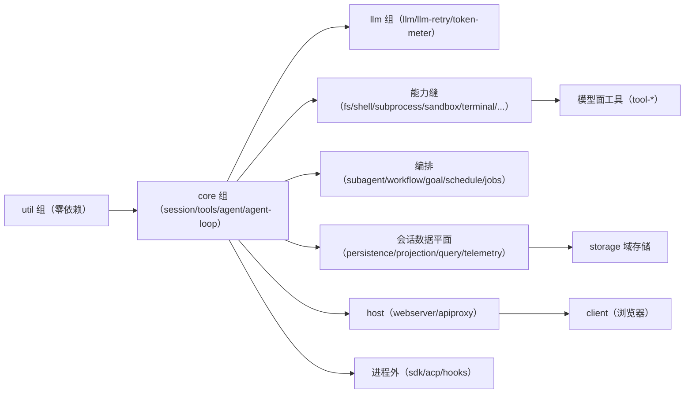

# DeepSeek Harness（dsh）源码架构与算法分析

> 分析对象：https://github.com/deepseek-ai/deepseek-harness.git（本地 checkout：`F:\deepseek-harness`，版本 `0.1.0-rc.5`）
> 文档基于仓库源码、`docs/` 目录下的架构文档、子系统参考、生成目录（module-graph / tool-catalog / config-catalog）与核心实现源码编写。
> 本文档为独立整理的分析文档，供架构理解、二次开发与代码走读参考。

---

## 1. 项目概述

DeepSeek Harness（`dsh`）是 DeepSeek AI 开源的 **Agent Harness（智能体运行时/执行框架）**，MIT 许可，当前处于 *developer preview* 阶段（API 可能随时破坏性变更）。

- **定位**：不是模型，而是承载"智能体"的运行时：负责模型调用、工具执行、会话持久化、权限沙箱、Web GUI、子代理编排、工作流执行等一整套工程能力。
- **技术栈**：TypeScript + ESM（全仓库 `"type": "module"`），pnpm workspaces monorepo，Node `^22.19 || >=24`；前端为自研模块化 Web 客户端（无框架约束，React 组件库在 `client-web-react`）。
- **核心思想**：**一切皆插件（everything is a plugin）**。底层是 vendored 的 [Cordis](https://github.com/cordiverse/cordis) 插件框架（其设计思想见 *A Programming Paradigm for Spatiotemporal Composability*）。模型适配器、工具注册表、会话日志、乃至 agent 循环本身都是插件，因此**每一个部件都可以从配置层面替换**。
- **运行方式**：`npx @deepseek-ai/dsh web` 启动 Web UI（默认 http://127.0.0.1:3080）；`dsh --profile headless "task"` 一次性执行任务；另有 ACP（Agent Client Protocol）自动化服务、JSON-RPC SDK 与 Python SDK 等对外接口。

### 1.1 仓库布局（顶层）

| 目录 | 内容 |
|---|---|
| `vendor/` | vendored Cordis 框架源码（context/events/fiber/logger/registry/service 等） |
| `packages/<group>/<pkg>/` | 全部 `@deepseek-ai/dsh-*` 工作区包，按能力分组 |
| `apps/cli` | `dsh` CLI 入口（bin）、profile 引导、参数解析 |
| `apps/web` | Web 前端薄入口（真正的壳在 `client-web`） |
| `docs/` | 架构文档、子系统参考、生成目录（module-graph、tool-catalog、config-catalog 等） |
| `examples/` | 可运行组合（agent-spine-demo、acp-demo、jsonrpc-demo 等） |
| `native/` | `node-addon-landlock-run`（Linux Landlock 沙箱原生实现） |
| `python/` | Python SDK 与打包运行时（`deepseek_harness` / `deepseek_harness_runtime`） |
| `scripts/` | 仓库门禁与代码生成器（`gen-*`、`verify-*`、`run-gates` 等） |
| `website/` | VitePress 文档站点 |

---

## 2. 总体架构设计

### 2.1 Cordis：插件框架底座

Cordis 是 dsh 的运行时内核，vendored 于 `vendor/cordis`。五个核心概念（见 `docs/cordis-primer.md`）：

1. **插件（Plugin）= 实现 Service 的对象**：可以是带 `inject`/`apply(ctx)` 的函数，也可以是 `Service` 子类；其生命周期由 Cordis 挂载进当前 Context。
2. **上下文（Context）= 服务的仓库**：服务占据稳定的 `ctx.<key>`（如 `ctx.tools`、`ctx.llm`、`ctx.sessions`），其他插件按键查找，而非 import 具体实现——实现与依赖解耦。
3. **`inject` 声明服务依赖**：插件声明需要的服务，框架在服务存在后才激活插件，**加载顺序由服务依赖表达，而非手工编排**。
4. **类型化事件（Typed Events）**：服务通过 TypeScript declaration merging 声明事件名，再以 `emit`（观察、不等待）、`parallel`（并行等待）、`serial`（按序、短路）、`waterfall`（环绕中间件、可短路）分发。
5. **注册即可逆效果**：提示词分段、工具 schema、适配器、provider、监听器都通过 `ctx.effect()`/`ctx.on()` 安装，插件卸载时按序撤销——**没有需要修补的特权核心**。

**Waterfall 语义**（最核心的扩展机制）：监听器收到 `(...args, next)`，调用 `next()` 委托给链上下一环（值经 next 的返回值传播）；不调用 `next()` 即短路、由该监听器拍板。策略类事件（如 `agent/pre-step`、`tools/pre-execute`）正是用短路表达决策。

### 2.2 Profile + Bundle：分层组合系统

一个运行的 dsh 是一棵**插件树**，由启动时按序叠加的补丁层组合而成（`packages/boot/app-boot`）：

- **Profile（配置文件）**：Harness home（`$DSH_HOME`）下的具名组合，列出叠加的 bundle、持有的外部插件与用户自己的 `cordis.patch.yml`。`web` 与 `headless` 是内置模板。
- **Bundle（包）**：Cordis 配置行 + 其装载代码的**分发格式**，保证上层补丁可继续覆盖。`dsh-base` 是每个 profile 的第一层（模型适配器、工具、持久化、沙箱与审批策略、设置、凭据、遥测）；`dsh-web-app` 在其上叠加浏览器应用；`dsh-headless` 叠加一次性运行器（无服务器）。
- **分层顺序**：bundle 列表顺序 → profile 的 `cordis.patch.yml` → home 级补丁 → `--patch` 覆盖。补丁按行 id 定位，**整行替换 config**（无深合并）。`dsh --profile web --dump-config` 可打印实际启动的插件树。
- **`!!js` 表达式**：`cordis.yml` 允许 `!!js` 表达式按进程环境动态求值（如按平台启用 bash/pwsh 行）。

这一设计让"换一个 provider 就换整个产品行为"成为可能：例如把 `fs`/`subprocess` provider 指向远程沙箱，bash、PTY、LSP 会随之全部迁移，无需 provider 分支。

### 2.3 能力接缝（Capability Seam）：Service Definition / Provider / Consumer

dsh 对可替换能力有一套统一的三角色结构：

| 角色 | 职责 | 例子 |
|---|---|---|
| **Service Definition** | 声明接口（抽象 Service + 词汇表） | `dsh-fs`（`ctx.fs`）、`dsh-shell`（`ctx.shell`）、`dsh-subagent`（`ctx.subagents`） |
| **Service Provider** | 实现接口，可并存/按名注册 | `fs-local`、`bash-local`/`bash-sandbox`、`subagent-spawn-in-process`/`-fork`/`-acp`/… |
| **Consumer** | 使用接口，通常是模型可见工具 | `tool-fs`（read/write/edit）、`tool-bash`、`tool-subagent` |

关键纪律：**一个角色不是接缝**；新增能力必须设计全三角色。扩展插件只依赖 Service Definition，从不依赖具体 provider（`agent-loop` 可被替换，UI/hook/tool 插件只依赖 `dsh-agent`）。模型侧词汇由唯一 consumer 拥有，因此 **provider 交换不改变模型接口**。

### 2.4 事件溯源：会话日志是唯一事实来源

核心数据模型（`core/session`，`ctx.sessions`）：

- 一个 `Session` 是**只追加（append-only）的类型化 `SessionEvent` 日志**，是智能体全部交互历史的单一事实来源。
- **LLM 消息历史由日志派生**（`deriveMessages()`），从不单独存储；重放即重新派生。
- **"模型可见 ⟺ 已记录"**：任何进入模型请求的内容都必须能从日志重建，运行时不变式（`dsh-invariants`）强制这一点。新模型可见输入必须新增 session 事件。
- 派生历史经过一个**有序 surface**：仅 `user/message`、`assistant/message`、`tool/result` 三类"消息产生事件"带 `surfaceOp`（`append` 或 `replace`），compaction 用 `replace` 把一段历史压成一个摘要节点而不破坏日志本身。
- 持久化、fork、resume、转写、遥测、标题、session-query 全部从这条日志流派生。

### 2.5 两个平面：Host（主机）与 Client（浏览器）

Web GUI 采用"双平面"架构：Node 侧 `packages/host`（webserver、api-proxy、plugin-inventory、frontend-static）与浏览器侧 `packages/client`（模块系统、connection、ui-* 插件）。两端通过 Typert RPC（`/api`）与事件流通信，浏览器插件表由 host 组装成 `window.__DSH_BOOT__` 入口图注入。构建侧用 `DSH_BUILD_FACE=host|client` 区分两个 TypeScript 程序，Host 与 Client 工件永不进入同一个 ts.Program。

### 2.6 核心服务地图（ctx 键）

| ctx 键 | 包 | 职责 |
|---|---|---|
| `ctx.sessions` | core/session | 事件溯源会话日志与内存 store |
| `ctx.systemPrompt` | core/system-prompt | 提示词分段与工具 schema 装配 |
| `ctx.tools` | core/tools | 作用域工具注册表与受守卫的执行管线 |
| `ctx.agents` | core/agent | Agent 接口、实时注册表、`agent/*` 事件 |
| `ctx.agentLoop` | core/agent-loop | 默认循环驱动（可替换） |
| `ctx.llm` | llm/llm | 消息/流词汇 + adapter 接缝 |
| `ctx.subagents` | subagent/subagent | 子代理 provider 注册表 |
| `ctx.workflowEngine` | workflow/workflow | 工作流引擎 |
| `ctx.goals` | goal/goal | 同会话目标服务 |
| `ctx.jobs` | jobs/jobs | 后台任务运行时 |
| `ctx.shell` | shell/shell | bash 执行器接缝 |
| `ctx.fs` | fs/fs | 文件系统接缝 |
| `ctx.sandbox`/`ctx.sandboxPolicy` | sandbox/* | 进程沙箱接缝与策略 |
| `ctx.sessionPersistence` | session/session-persistence | 会话持久化接缝 |
| `ctx.sessionQuery` | session-query/session-query | 会话检索 |
| `ctx.sessionTitle` | session/session-title | 会话标题 |
| `ctx.settings`/`ctx.credentials` | settings/credentials | 用户设置与凭据接缝 |
| `ctx.typert`/`ctx.typertGateway`/`ctx.remote` | typert/*、api/* | 类型化 RPC 注册表/网关/客户端 |
| `ctx.webServer` | host/webserver | HTTP 服务器 |
| `ctx.compaction` | compaction/compaction | 上下文压缩引擎 |
| `ctx.tokenMeter` | llm/token-meter | token 计量 |
| `ctx.commands` | interaction/commands | 人类命令注册表 |
| `ctx.approval` | interaction/user-approval | 审批接缝 |
| `ctx.userQuestions` | interaction/user-questions | 向人提问接缝 |
| `ctx.spillStore` | spill/spill | 大输出外溢存储 |
| `ctx.attachments` | attachment/attachment | 持久图片附件 |
| `ctx.workspaceRegistry` | workspace/workspace | 工作区 |
| `ctx.terminals` | terminal/terminal | 持久 PTY 会话 |
| `ctx.subprocess` | subprocess/subprocess | 子进程接缝 |
| `ctx.codeRuntime` | code-runtime/code-runtime | 代码执行接缝 |
| `ctx.lsp` | lsp/lsp | 语言服务器接缝 |
| `ctx.skills` | skill/skill | 技能注册表 |
| `ctx.web` | web/web | 网页搜索/抓取接缝 |

---

## 3. 核心算法思想

### 3.1 Turn / Step 循环（agent-loop）

**Turn（轮次）** = 从领取输入到"不再欠账"的完整处理周期；**Step（步骤）** = 一次模型请求 + 其引发的工具执行。一个 turn 含零或多个 step。实现位于 `packages/core/agent-loop/src/agent.ts`（`ReactLoopAgent`，状态机 `idle → running → idle`）。

伪代码流程：

```text
turn/start
  claim 下一个 turn 的输入 + 全部排队消息（inbox）
  assemble 提示词分段 + 工具 schemas（ctx.systemPrompt.assemble）
  → agent/pre-step 瀑布（可 reject 或改写消息批）
     reject / 空改写 → 以无 step 的方式关闭该 turn
     step/start
     逐条 append user/message
     deriveMessages() 从日志派生模型历史
     agent/request 瀑布 → llm/stream 瀑布（chunk* → assistant/chunk）
     → assistant/message（BlockAssembler 组装）
     工具调用 → executeToolCalls（tool/call* → tool/result*）
     step/end
     工具还欠请求 或 收到 next-step 输入 → 继续下一步
  → agent/turn-stopping（serial，关闭前检查点）
turn/end { reason }
```

关键设计：

- **每次请求都是日志的纯函数**：`deriveMessages()` 从会话日志派生模型历史，配合 `request/header` 事件（记录 call config + system prompt + 工具 schema 快照），使"下一次请求"完全可由日志重建（可重建性不变式）。
- **inbox 三通道**：`followup`（下一 turn，唤醒）、`steer`（下一步边界，唤醒）、`inject`（下一步边界，不唤醒——注入上下文静默排队，直到别的消息唤醒）。`agent/inbox/*` 事件记录插入/认领/丢弃，UI 可从持久日志重建队列。
- **可取消与收敛**：`cancel(cause)` 中止活动并记录 `AgentCancelCause`（user/parent/hook/disposed）；中止后到达的唤醒输入被锁存（wake latch）并在收敛到 idle 后重放；`whenIdle()` 等待整机静止。
- **max-tokens 粘性**：一旦某 step 触顶，后续正常完成的 step 不得把 turn 结局降级为 completed。
- **错误结构化**：所有失败归一为 `LlmFailure`（message + code + 可选 status/retryAfter/requestId）；失败 step 先关闭，再交 `agent/request-error` 瀑布决定是否重试。

### 3.2 工具调用调度（tool-calls.ts）：独占屏障 + 有界滚动池

当一步出现多个工具调用时，`executeToolCalls` 按 `ctx.tools.executionMode(call)` 分类调度：

- **exclusive（独占）**：单独执行，形成**排序屏障**（之前的并行池先排空）。
- **parallel（并行）**：进入**有界滚动池**，在飞数量不超过 `maxParallelToolCalls`（默认 1=串行；可经设置热改，下一个分组生效）。
- 每个分组开始前**重新分类**（注册表可在提交之间变化而制造屏障）；分发可以重叠，但**策略、结果、结果上下文严格按模型顺序提交**（`commitReady` 只推进连续序号的槽位）。
- 中止时：已启动的调用排空并提交结果，未启动的调用补记**合成错误结果**（`TOOL_ABORTED_BEFORE_DISPATCH`），保证重放有效；调度器内部失败则停止补发、排空已启动调用、不伪造结果。
- 工具可声明 `isConcurrencySafe` 加入并行组，但不得修改父级状态。

### 3.3 工具执行管线（tools 注册表）

一次工具调用经历完整管线（`tool-execution-pipeline.md`）：

```text
model tool-call 块
 → tool/call 会话事件（记录原始 arguments JSON 字符串）
 → tools/pre-execute 瀑布（allow/deny/ask 决策，可短路）
 → 单调 ToolGuard（注册顺序即优先级，不可重排）
 → tools/execute 环绕瀑布（超时策略、重试、指标；只有此层可替换 signal）
 → ToolDefinition.execute() 主体
 → （tool-fs 变更会先触发 fs/write-intent / fs/edit-intent 意图门）
 → tools/post-execute 瀑布（检查/替换结果）
 → finalizeContent（注册时快照的"最后一英里"内容变换，总函数、不得抛）
 → tools/result 同步通知（冻结的权威结果）
 → tool/result 会话事件（携带 isError、可选 error 身份、可选 meta）
```

- 参数解析一次、深冻结后进入策略管线；工具自校验自己的 schema（`defineTool` 从 `ValueSchemaSpec` DSL 编译 JSON Schema 并推断 TS 类型，16 层容器后回退 `JsonValue`）。
- 工具可 `deferContext()` 把嵌套分派的上下文挂到自己结果上、`concludeTurn()` 声明终局结果；`additionalContexts` 在结果之后按 FIFO 注入下一步。
- 结果规范值必须满足 `output.schema`（`ToolOutputError`）；规范化失败统一转 `isError`。
- 工具 schema 经 `schemas()` 白名单投影给模型——`execute`、`timeoutMs`、`isConcurrencySafe`、`presentCall` 等**永不漏到线上**。

### 3.4 会话日志与派生历史（session）

- **`SessionEvent`**：按 `type` 判别的闭联合 `{type, seq, time, data}`；`seq = log.length` 保持连续；`data` 在 append 时经一次递归"读取-校验-复制"确保无损 JSON 可序列化（BigInt/函数/循环引用等在源头被拒）。
- **事件词汇**（`SessionEventMap`，声明合并可扩展）：`turn/start|end`、`step/start|end`、`user/message`、`assistant/chunk`（原始流块，逐 token 保真）、`assistant/message`、`tool/call|result`、`todo/write`（整表快照）、`request/header`、`request/context`、`session/end-seed`；插件合并扩展如 `compaction/*`、`hook/invoked`、`goal/change`、`schedule/change`。
- **surface 与 `deriveMessages()`**：仅三类消息事件进 surface；`replace` 操作把被压缩的节点从派生历史中摘除。投影缓存：每个 surface 节点首次见时投影一次，改写（replaceGeneration 递增）时重建；返回冻结共享消息的**新数组**。
- **`ignorable` 标记**：未知事件类型默认必须拒绝重建（宁可过度拒绝，也不静默截断会话）；纯信息事件标记 `ignorable: true`。

### 3.5 持久化与崩溃恢复（session-persistence）

- **flush checkpoint**：`session/event` 是同步通知，持久化插件异步缓冲；首个待写事件开启固定批量窗口（后续事件不重置截止），`session/flush` 取消等待并排空到静止——循环在认领下一 turn 前用它做排序与错误观察检查点。
- **崩溃恢复**：加载发现孤儿 `turn/start`（无 `turn/end`）**不截断**（单 turn 可能巨大），而是补一条合成 `turn/end { reason: { kind: 'interrupted' } }`；只修冷会话，live 会话拒绝修复。
- **两个后端**：JSONL（默认校验和 Zstandard 帧压缩，逐会话一文件，原子写）与 SQLite（`node:sqlite`，一行一事件，列与事件 1:1 映射）。共享同一 `runPersistenceContract` 契约测试套件。
- **格式拒绝**：header `version` 高于/低于 `SESSION_FORMAT_VERSION` 时分别报"升级 harness"/"无迁移路径"，事件类型不在生成的 `KNOWN_SESSION_EVENT_TYPES` 且无 ignorable 标记时同样拒绝。

### 3.6 上下文压缩（compaction）

可选能力缝（`ctx.compaction`，backend `compaction-basic`）：把一段 surface 压成一个摘要节点。

- **`compaction/start → summarization → compaction/summary → user/message(replace) → compaction/end`**：start 先落、end 最后落，构成覆盖整个操作的**日志锁**；崩溃留下可检测的孤儿锁。
- **触发**：`pressure`（token 压力）在 serial `agent/pre-step` 前检查；`context-overflow`（provider 确认的 `CONTEXT_WINDOW_EXCEEDED`）可强制做有收益的压缩。压缩前可先用 `toolResultPruner` 裁剪超大工具结果（头 4096 + 尾 1024 字符保留）。
- **边界约束**：被替换区间必须保持工具调用/结果配对平衡（`toolPairingBalancedBefore/After`）；`replace` 区间按 surface 位置（而非 seq 数值）指定。
- 计量交给单例 `ctx.tokenMeter`（沿持久尾部重放，`usage` 或启发式估算两种基线）。

### 3.7 同会话目标（goal）与轮次机制

`ctx.goals` 为长期目标维护持久生命周期：

- **事件溯源**：每次变更写 durable `goal/change` 事件（完整快照或 clear 墓碑），严格折叠重放派生状态。
- **CAS 修订**：`GoalRef = {id, revision}`，每次接受的变更递增 revision；`update_goal` 类操作必须带期望 revision。
- **相位状态机**：`active / paused / blocked / complete`；blocked 带稳定 code + 人类可读 message（默认最低 3 轮才允许 blocked）。
- **轮次推进**：仅带 `GoalMessageSource {goalId, revision, round}` 属性的 `user/message` 事件推进 `roundsStarted`；重放拒绝非正轮次、缺口、过期修订、停止相位与超 cap。
- **激活与持久相位分离**：进程本地 activation（是否允许自动续轮）与持久 phase 分开；生命周期所有者卸载 driver 前 `disarm`，之后需人授权的 `resume` 记录新的激活边。`create/edit/pause/resume` 要求直接人类根权威，`complete/blocked` 还接受"当前确切轮次"。

### 3.8 子代理（subagent）与工作流（workflow）

- **子代理接缝**：provider 按名共存于 `ctx.subagents`（spawn-in-process / fork-in-process / acp / claude-code / codex / dsh-sdk）。provider 以静态 capabilities（outputSchema / depthLimit / toolFilter / persona）在 start 前被校验，缺能力即 loud fail，绝不"接受后忽略"。**一次性** vs **可续接**（continuable，经子代理自身 Agent inbox 的 followup FIFO 多轮，支持冷恢复与 `send_message`/`interrupt_agent`/`report`）。
- **工作流**：模型编写 JS 编排脚本（顶层 await，`return <json>`），引擎（`workflow-worker-thread`，每运行一个 worker + vm 上下文，超限即终止 worker）提供 `agent()`/`pipeline()`/`parallel()`/`phase()`/`log()` 钩子；meta/args 纯 JSON，先校验 meta 再运行，绝不求值脚本取 meta；`WorkflowRun.result` 永不 reject（失败以 `stopReason: 'error'` 解析）；脚本钩子误用（parallel/pipeline 重抛）是致命错误，不溶成 null。
- **Ralph（tool-ralph）**：固定脚本的"每轮全新子代理"循环，向不可变目标迭代，靠共享工作区做记忆，跨轮只传递有界结构化报告。

### 3.9 后台任务（jobs）

`ctx.jobs` 为长运行生产者（bash 后台、subagent、PTY send）提供统一身份/生命周期/访问控制：`JobId = <kind>-N`（`JobKindMap` 声明合并扩展）；状态机 `running → stopping → completed|killed|failed`；生产者契约 `JobStart + JobHooks`（`run()` 一次、`cancel` 幂等、`done` 表示资源已释放、可选 `readOutput` 区分流式/仅最终输出）；`job_output/job_list/job_kill` 三工具统一收集与停止。

### 3.10 权限、审批与沙箱

- **`SandboxMode`**：`read-only / workspace-write / danger-full-access`，只治理文件效果；执行完整性 `full|partial`（Landlock 旧 ABI、Windows ACL 的 Everyone/硬链接边界是当前 partial 案例）。
- **按调用携带策略**：`ctx.sandboxPolicy.resolve()` 用会话 cwd 决定工作区根，`ctx.sandbox.confine(argv, policy)` 返回替换 argv + 拒绝方言（EROFS/EACCES/EPERM）+ 运行器失败规则；消费者用 stderr 方言区分"沙箱正常但拒绝"与"运行器自身失败"；静默非受限透传永远非法，无后端即 `SANDBOX_UNAVAILABLE` fail-closed。
- **审批**：`ctx.approval.request` 要求 open turn 内，先 `approval/asked`、取 outcome、再 `approval/decided`（只记录审计对，不进模型转录）；outcome fail-closed（仅 `allowed-once` 放行）；会话策略 `ask`/`never`。沙箱升级重试（`sandbox_permissions + justification`）必须经审批且只放行那一次调用。
- **权限预设**：`permission-presets` 把 sandbox/mode 与 approval/policy 两个旋钮捆绑成具名预设，只写意图，由 `sandbox-policy`/`user-approval` 写透。

### 3.11 LLM 适配器契约与重试

- **`StreamChunk`** 封闭判别联合（block-start/text-delta/reasoning-delta/tool-call-delta/block-end/usage/finish）；工具参数全程保持**原始 JSON 字符串**；usage 必须在 finish 前、finish 后无内容。
- **一次 adapter 调用 = 一次 provider 尝试**（adapter 禁用库级重试）；`agent/request-error` 瀑布决定 agent 级重试，重开一个 durable 编号的 turn。
- **`ResolvedRetryPolicy`** 在路由注册前解析为不可变值（normal/always + 退避字段），调用选中注册后随流捕获——路由后续卸载/替换不影响在飞失败的恢复策略；`EMPTY_RESPONSE`（空完成视为可重试错误）默认重试。
- **上下文溢出唯一规范码** `CONTEXT_WINDOW_EXCEEDED`；流空闲看门狗默认 5 分钟；每个 provider HTTP 请求携带强制 `User-Agent` 归属头。


---

## 4. 功能模块详解

> 本节按 packages 分组逐模块说明功能、关键机制、相关 npm 包与依赖方向。所有包名省略 @deepseek-ai/ 前缀。

### 4.1 core 组 —— 产品 API 主干

| 包 | 职责与机制 | 依赖 |
|---|---|---|
| **session**（ctx.sessions） | 事件溯源会话日志与内存 store（详见 3.4）。提供 create/prepare/enter/announce/flush/fork；fork 可从任意稳定 turn 间位置分支，seed 边界写 session/end-seed。 | 无（最底层） |
| **system-prompt**（ctx.systemPrompt） | 提示词分段装配：section()（按 order 升序拼接，-100 宿主身份、0 人设、100-199 工具指引；complete 段成为唯一段）、context()（动态上下文）、tools()、variable()（{{var}} 事后插值）、suppressRuntimeContext()。装配经 system-prompt/assemble 瀑布（scope 过滤）。 | dsh-scope |
| **tools**（ctx.tools） | 作用域工具注册表 + 受守卫执行管线（3.3）。ToolRestriction allow/deny 过滤继承工具；executionMode 供调度；Code Mode 保留 run_code 传输。 | dsh-scope、dsh-brand |
| **agent**（ctx.agents） | Agent 接口、实时注册表、initiator scope、agent/* 事件词汇。AgentHandle.dispose 是能力（只有持有者可拆）；AgentFactory 让 loop 通过 setFactory() 注册，消费方不依赖具体 loop。 | dsh-scope |
| **agent-loop**（ctx.agentLoop） | 默认驱动实现（3.1-3.2）：工厂式 ownership（AbortController 融合调用方/owner fiber/工厂三种取消源）、ReactLoopAgent 状态机、工具调度器、configuredAgentIdentities 启动身份。 | agent、session、llm、tools、systemPrompt、settings |
| **scope** | 无依赖库原语：ScopeKey（对象身份）、Scoped（路由接收器）、Scope（注册上下文 + 双拆除路径）、ScopedLayers（全局层 + 惰性 scope 层）。 | 无 |

### 4.2 llm 组 —— 模型能力族

| 包 | 职责与机制 | 依赖 |
|---|---|---|
| **llm**（ctx.llm） | 抽象服务 + Message/ContentBlock/StreamChunk 词汇 + BlockAssembler + adapter 契约（3.11）；llm/stream waterfall 是全部模型调用的拦截点（重试/重放/路由）。 | attachment、brand、timeout |
| **llm-deepseek** | DeepSeek 官方 adapter：Chat Completions / Messages 两套端点，每次请求经 credentials.resolve() 解析 key；暴露 maxTokens 等精确模型默认；模型发现（picker 列表）。 | llm、credentials、settings |
| **llm-pi-ai** | 多 provider 聚合 adapter（PI AI）：按 settings 节动态注册/注销路由，validate 在写入时拒绝无法服务的 profile。 | llm、settings、credentials |
| **llm-retry** | llm/stream 环绕的 provider 路由重试策略（按 ResolvedRetryPolicy 退避重试可重试码）。 | llm、timeout |
| **token-meter**（ctx.tokenMeter） | 会话级不可变重放计量：TokenMeasurement（logRevision/baseline/surfaceDeltaTokens/totalTokens/nodes），measure() 沿持久尾部重放、克隆位置节点，O(surface)。 | llm、session |

### 4.3 执行与 IO 能力族（fs / shell / subprocess / terminal / sandbox / code-runtime / spill / attachment / workspace）

| 包 | 职责与机制 | 依赖 |
|---|---|---|
| **fs**（ctx.fs）+ **fs-local** | 文件系统接缝：路径解析为不透明 FsTarget + 版本令牌 FsVersion；writeText/editText 可带守卫意图（createIfAbsent/replaceIfVersion）；编辑是提供者级原子变异（匹配/换行/陈旧检查/原子替换在同一临界区）；fs/write-intent、fs/edit-intent 单槽决策瀑布、fs/observed 即发即忘记录。**fs-observation-policy**：记录已观察状态 + 新鲜度规则（read-before-write/edit 默认策略）。 | brand、invariants |
| **tool-fs / tool-fs-search / tool-str-replace-editor** | 模型面消费方：read/write/edit/read_image（窗口化读取、渲染）、glob/grep（打包 @vscode/ripgrep 二进制经 ctx.subprocess 执行、超限结果经 spill 落盘）、str_replace_editor（独立视图/创建/唯一字面替换/行插入工具）。 | fs、subprocess、spill、attachments |
| **shell**（ctx.shell）+ **bash-local/bash-sandbox/pwsh-local/pwsh-sandbox** | bash 执行器接缝：request/spec 分离（resolve() 补默认值）；前台结果 timedOut/aborted/signal/exitCode 独立上报（先因分类）；截断保留尾部 + 完整流 spill 文件；后台返回 ShellProcess 句柄（增量 readOutput）；DSH_* 托管环境经 ctx.shellEnv 注入；沙箱执行器上报 mode/denied/enforcement/runnerFailed。 | subprocess、sandbox、jobs |
| **subprocess**（ctx.subprocess）+ **subprocess-local** | 子进程接缝：完全显式 spawn spec（无默认）、逐流 stdio 处置（pipe/inherit/collect+spill）、偏移式非消耗读取（独立读者互不偷数据）、进程树级终止（SIGTERM→grace→SIGKILL 升级；Windows taskkill /T）、凭证擦洗、DSH_* 命名空间。 | timeout、invariants |
| **terminal**（ctx.terminals）+ **terminal-bash** | 持久 PTY 会话：后端可替换（type 注册）、精确 Agent 授权、独占发送操作（消费式输出游标）、滚动缓冲分页读、SIGINT 取消、清理挂到 owner scope 且跨重载存活。 | subprocess、shell |
| **sandbox**（ctx.sandbox / ctx.sandboxPolicy）+ **sandbox-local/sandbox-policy/sandbox-windows-acl** | 进程沙箱接缝（3.10）：本地 provider 用 bwrap/Landlock（Linux）、Seatbelt（macOS）、ACL restricted-token（Windows，含 node-addon-landlock-run 原生 addon）；ConfinedArgv 携带拒绝方言与运行器失败规则；fail-closed。 | invariants |
| **code-runtime**（ctx.codeRuntime）+ **code-runtime-worker-thread** | 代码执行接缝：运行模型编写的 async 函数体（支持顶层 await/return），绑定命名空间（CodeBindingFunction 跨结构化克隆边界），捕获 logs + value；失败分类正交（exception/timeout/abort/worker-exit/invalid-output/output-limit），错误是结果字段而非拒绝。Code Mode：run_code 保留传输把子调用送进完整守卫管线。 | invariants |
| **spill**（ctx.spillStore）+ **spill-local/spill-policy** | 大输出外溢：saveText 持久化全文、返回不透明 SpillLocator + 检索提示；local 后端写 <root>/session-<hash>/<random>-<safeName>（0700、wx 独占防符号链接）；policy 在 tools/post-execute 用首尾预览 + 引用替换超限结果（失败则保留内联）。 | brand |
| **attachment**（ctx.attachments）+ **attachment-local** | 持久图片附件：persist-before-event（对象持久后才发布内容寻址引用）；saveImage 校验并原子提交、readImage 每次重验摘要；引用携带类型/字节/宽高供免解码排版。 | brand、invariants |
| **workspace**（ctx.workspaceRegistry） | 工作区记录：uuid id + realpath 规范化路径唯一性 + 会话有序账目；经 storage domain 表单持久化；对模型不可见。 | storage-domain、session-persistence、session |

### 4.4 知识能力族（web / lsp / skill / context / todo / plan / guard）

| 包 | 职责与机制 | 依赖 |
|---|---|---|
| **web**（ctx.web）+ **web-fetch-http / web-search-deepseek / web-search-exa / web-search-perplexity** + **tool-web** | 网页搜索/抓取接缝：provider 按名注册、available() 只做本地检查、执行时顺序无关选择；web_search/web_fetch 模型面 schema 稳定；非 2xx 抓取是结果而非失败；WebError 统一错误码。 | llm、brand |
| **lsp**（ctx.lsp）+ **lsp-stdio** + **tool-lsp** | 语言服务器接缝：仅四个封闭操作（goToDefinition/findReferences/goToImplementation/hover）；stdio provider 配置化托管语言服务器子进程；不暴露协议类型/JSON-RPC 逃生口。 | subprocess |
| **skill**（ctx.skills）+ **skill-filesystem / skill-badge** + **tool-skill** | 技能注册表：host+per-scope 分层（最近层同名胜出）；本地 provider 按 rank 扫描根目录（project→bundled）、Chokidar 监视；skill 工具在首个 pre-step 注入 <system-reminder> 目录，按 kebab-case 名 + isModelInvocable 放行加载。 | agent、scope |
| **agent-instructions** | 从工作区读取 AGENTS.md/CLAUDE.md 注入上下文（maxBytes 上限）。 | session、fs |
| **time-context / session-reference / tmux-context** | 请求上下文插件：当前时间、跨会话引用候选/准备消息（只取当前 surface 快照）、tmux 状态。 | session、session-title |
| **tool-todo** | todo_write：整表快照写 todo/write 事件；最小三态（pending/in_progress/completed），无 id（整表替换）。 | session |
| **plan-mode** | plan 模式：plan/mode 只记录整值替换事件；激活时渲染 plan:policy 段；exit_plan_mode 常驻注册（非 plan 模式执行即拒绝），经 user-questions 缝呈现审阅，批准返回 {approved:true}。 | tools、user-questions |
| **repeat-tool-reminder / tool-call-timeout-policy** | 循环卫生：连续重复工具提醒（阈值 3/5/8）；tools/execute 环绕的协作式超时（尊重 timeoutMs，要求工具转发 signal 可达静止）。 | tools |


### 4.5 编排能力族（subagent / workflow / goal / schedule / jobs）

| 包 | 职责与机制 | 依赖 |
|---|---|---|
| **subagent**（ctx.subagents） | 子代理接缝（3.8）：Service Definition 定义词汇与 provider 注册表；provider 静态 capabilities 在 start 前校验，缺能力 loud fail（UNSUPPORTED_CAPABILITY）；一次性经 start() 发布 SubagentRun（可带 outputSchema 结构化结果）；可续接子代理由续接管理器持有进程内 Activation，经子代理自身 inbox 的 followup FIFO 多轮，支持冷恢复、interrupt、reportFrom；descriptor 是模式判别（one-shot/continuable）的持久身份；subagent/start、subagent/end 事件 observe-only 且按父代理 scope 分发。 | agent、session、jobs、scope |
| **subagent-spawn-in-process / subagent-fork-in-process / subagent-in-process-driver** | 进程内 provider：spawn（新 Agent + 新会话，父上下文不继承）；fork（用父日志平衡完整轮前缀作 seed，子会话带 parentSession/seedLength/delegationDepth；fork 子代理保持 one-shot）。 | subagent、agent-loop、session |
| **subagent-acp / subagent-claude-code / subagent-codex / subagent-dsh-sdk** | 进程外 provider：把委托转成 ACP 自动化服务器、Claude Code/Codex CLI、或 dsh SDK 运行时上的子代理轮次。 | subagent、sdk、hooks |
| **tool-subagent / tool-subagent-control / tool-subagent-report** | 模型面消费方：subagent（可按 toolName 配多实例：subagent=continuable 后台默认、subagent_fork=one-shot 前台默认）；interrupt_agent/list_agents/send_message（全局控制工具，list 依赖 sessionProjections 与实时 Agent 注册表）；report（可续接子代理内的返回通道，注册 child-scoped tool:report 提示段）。 | subagent、agents、sessionProjections |
| **workflow**（ctx.workflowEngine）+ **workflow-worker-thread** + **tool-workflow** | 工作流接缝（3.8）：每运行一个 worker + vm 上下文；agent/pipeline/parallel/phase/log 钩子；parent 必填（每个 agent() 子代理归属给它）；WorkflowRun.result 永不 reject；workflow/* 事件只携带数据快照、per-listener 隔离；tool-workflow 写 tool-workflow/run-start、run-end 会话记录；client-ui-workflow-run 折叠为会话内 Chat 节点。 | subagent、agent、session |
| **tool-ralph** | Ralph 循环：固定脚本的"每轮全新子代理"迭代（subagentProvider + maxRounds 上限）。 | workflow、subagents |
| **goal**（ctx.goals）+ **goal-round-driver** + **tool-goal** + **command-goal** | 同会话目标（3.7）：事件溯源 + CAS 修订 + 相位状态机 + 轮次归属；goal-round-driver 在 agent/* 事件上驱动自动续轮；goal/changed 按 agent scope 过滤分发；/goal 命令。 | agent、session、scope |
| **schedule**（ctx.schedule） | 会话本地调度：after/at/every 三种 durable 记录；每个首目标规范化为 RFC 3339 UTC scheduledAt；every 追补只取最近到期目标并合并为一批 followup（约束模型轮次）；交付边界 session-local（原会话必须 live）；到点等 Agent 完全空闲、占维护阶段、refold 后 followup() 一次，从不 steer()；fork 只折叠 seedLength 后的记录。 | agent、session |
| **jobs**（ctx.jobs）+ **jobs-local** + **tool-jobs** | 后台任务运行时（3.9）：JobId/<kind>-N、生产者契约、LocalJobRegistry（maxConcurrentJobsPerOwner 默认 10）、owner 精确 Agent 准入、结算 first-wins；job_output/job_list/job_kill。 | agent、session |

### 4.6 会话数据平面（session 组：persistence / projection / query / telemetry / title / stats / reference）

| 包 | 职责与机制 | 依赖 |
|---|---|---|
| **session-persistence**（ctx.sessionPersistence）+ **-jsonl / -sqlite** | 持久化接缝（3.5）：locate/create/append/prepare/load/inspect/readFrom/list；flush checkpoint、崩溃恢复（interrupted 收尾）、格式拒绝；SessionHeader 元数据与日志分离存放。 | session |
| **session-projection**（ctx.sessionProjections）+ **session-projection-cache** | 日志派生投影接缝：注册表单次订阅 session/event，把事件折叠进纯函数单元（ProjectionDefinition {key, schema, init, apply, view}）；apply 对无关事件返回同一引用（Object.is 判定零下游）；缓存经 storage domain 的 session_projcache 域落盘（turn/end 与销毁强制点 + 节流 write-behind）；冷读阶梯：缓存 → readFrom 尾部 → restore → 回写。 | session、session-persistence、storage-domain |
| **session-query**（ctx.sessionQuery）+ **session-query-sqlite** | 会话检索：live 优先逻辑语料库；SessionEventSurface（current/shadowed/log-only）分类；过滤器 AND/值 OR/闭区间/大小写不敏感全文；血缘 trace（祖先+后代）、事件关系（replacedBy/sourceEventSeqs）；SQLite provider 管理全文索引生命周期。 | session、session-persistence、session-title |
| **session-telemetry**（ctx.sessionTelemetry）+ **-otel** | 出站遥测接缝：ledger 通道与会话日志 1:1 镜像（去重键 (session.id, event.seq)）、ops 通道承载 agent-error/shutdown；固定 chunk 投影（每 (turn,step) 只发第一条 assistant/chunk）；session-telemetry/record 脱敏瀑布（部署挂载，只改导出副本）；OTel 后端即 OpenTelemetry JS SDK 日志管线；DSH_TELEMETRY_MODE 默认 DISABLED。 | session |
| **session-title**（ctx.sessionTitle）+ **-llm / -first-prompt-llm / -all-prompts-llm** | 标题：latest-wins 的 session/title 只记录事件 + 可选异步 provider（first-prompt/all-prompts）；用户重命名即"钉住"；服务端校验 seq、规范化、字节上限。 | session |
| **session-stats / session-log-export** | 整轮 turn/step 计数投影（聊天统计条）；浏览器会话导出（/export 命令 + 下载对话框）。 | session、projection |
| **session-reference**（ctx.sessionReferenceResolver） | 跨会话引用：listCandidates（按 cwd 亲和度排序、排除自身、只搜 id 与 cwd）、prepare（入队前一次性快照全部引用，聚合为至多一份不可信上下文）；稳定错误码 SESSION_REFERENCE_*。 | session、session-title、agent |

### 4.7 人机交互族（commands / approval / user-questions / permission-presets / feedback / ask-user）

| 包 | 职责与机制 | 依赖 |
|---|---|---|
| **commands**（ctx.commands） | 人类命令注册表：插件注册 CommandDefinition，/xxx 直接执行不经模型；command/run、command/done 只记录事件；agent 注入的上下文子级可遮蔽全局命令。 | agent、session |
| **user-approval**（ctx.approval） | 审批缝（3.10）：open turn 内 approval/asked → outcome → approval/decided；fail-closed；策略 ask/never；approval/request 是 scope 过滤 waterfall；ACP 自动化桥为自身代理提供一次性机器决策。 | agent、session、scope |
| **user-questions**（ctx.userQuestions） | 向人提问缝：ask() 批量提问（稳定 id 回显、选项 label 即模型选中值、intent 只改呈现）；宿主把请求中继给连接客户端的活动 provider；agent 参数只接受实时 runtime root（子代理无人可答 → CALLER_NOT_LIVE/DELEGATED_CALLER）。 | agent |
| **permission-presets**（ctx.permissionPresets） | 权限预设（3.10）：sandbox/mode 与 approval/policy 捆绑；custom 为保留的派生"非预设"态；permission/preset 只记录事件；配置错误加载即失败。 | sandbox-policy、user-approval |
| **message-feedback**（ctx.messageFeedback） | 逐条消息反馈：独立 storage domain sidecar（message_feedback，刻意区别于会话事件）；严格乐观并发（ifVersion CAS + 每 session 队列）；提交前 flush 检查点 + 从 seq 0 重读再校验；经 TypertRemoteService 发布 list/put/delete。 | storage-domain、session |
| **tool-ask-user** | ask_user_question：暂停工具调用直到 UI provider 返回人类答案。 | user-questions、tools |

### 4.8 Host 与 Client（webserver / api-gateway / client-modules / web 前端）

| 包 | 职责与机制 | 依赖 |
|---|---|---|
| **host-webserver**（ctx.webServer） | HTTP 载体：命名路由注册表（exact→最长 prefix→fallback 匹配）、tapIndex 的 index.html 变换回调、唯一 owner 的 fallback 席位；host 仅允许 127.0.0.1/0.0.0.0，无 TLS/认证；close() 配 closeAllConnections() 防 SSE 悬挂。 | invariants |
| **host-frontend-static** | 认领 fallback 席位作 SPA dist 服务器。 | webserver |
| **host-apiproxy / api-gateway / api-remotes / client-connection** | Typert RPC 网关：@Remote/@RemoteScope 选方法；generator 严格分析 ts.Program 生成 Host/Client 工件（typert.host.js / typert.remote-client.js）；复杂对象经 TypertLookupMap 映射 wire id；client-connection 提供 POST /api/<ns>/<method> 的 RPC 载体、信任边界、取消、响应信封与 SSE 事件流。 | typert、webserver |
| **client-modules**（ctx.clientModules） | Web 插件表：扫描宿主 Loader 条目中声明 dsh.client 的包、组合 window.__DSH_BOOT__ 入口图、伺服 /plugins/<id>/client.js、tap 索引注入清单；rebuilt(id) 是 bundle 内容进入图的唯一入口（rev 真变化才重组）。 | webserver |
| **client-hmr** | 开发期 watch 驱动：轮询基线 + SSE 广播重建信号（pnpm run dev:web 配套）。 | client-modules、webserver |
| **client-web / client-web-react / client-runtime** | 浏览器壳内核：两阶段启动（模块面→插件面）、loader-status 手写（加载页在插件失败时仍可用）、AppRoot 门控；ui-* 插件（layout/sidebar/conversation/tool/goal/jobs/subagent/settings/theme/trajectory/…）渲染会话、工具卡片、目标栏、后台任务列表等。 | client-modules、connection |

### 4.9 进程外接口（sdk / acp / hooks / extensions / python）

| 包 | 职责与机制 | 依赖 |
|---|---|---|
| **sdk-protocol / sdk-client / sdk-jsonrpc-server** | 进程外驱动运行时：newline-delimited JSON-RPC on stdio 协议 + TypeScript 客户端 + 服务器插件；调用方自备运行时可执行文件与 cordis.yml。 | session、agent |
| **acp** | Agent Client Protocol 自动化服务器（进程外互操作传输，非展示层）；配套 out-of-process subagent client 在 subagent-acp。 | agent |
| **hook-protocol / hooks-claude-code / hooks-codex** | 把 Claude Code/Codex 的 shell hook 协议桥接到 dsh 的类型化拦截点：hook/invoked、hook/result 只记录事件；UserPromptSubmit/PreToolUse/PostToolUse/Stop 在 open turn 内触发。 | agent、session、subprocess |
| **cordis-host-runner / cordis-client-runner / tool-cordis / ui-cordis** | 运行时自修改：模型定义/运行/停止/反注册版本化 Cordis 包（vm 沙箱、动态插件注册表 ctx.dynamicCordisRunner）；cordis_define/cordis_run/cordis_inspect_* 工具默认不在任何出货组合（显式 opt-in）。 | agent、tools |
| **python/sdk、python/sdk-runtime** | Python SDK：high-level turns API + 低层 JSON-RPC 客户端；runtime carrier 打包平台二进制（含单文件 exe）与默认 agent 配置。 | （进程外） |

### 4.10 支撑族（settings / credentials / storage / identity / typert / util / invariants / preset）

| 包 | 职责与机制 | 依赖 |
|---|---|---|
| **settings**（ctx.settings）+ **settings-file** | 用户设置缝：SettingsNamespace 注册（schemastery schema + base/applies/validate）；解析序 schema 默认→base→user；深冻结快照；update 稀疏合并/整节 replace；describe(redactSecrets) 为 wire 面剥 secret；expectedRevision 防陈旧覆盖；settings/updated 深等值门控。 | brand、invariants |
| **credentials**（ctx.credentials）+ **credentials-local** | 凭据缝：配置只存 CredentialRef（环境变量名）；resolve() 每次操作重解析（轮换即时生效）；describe 不暴露值（configured/source/writable）；env 覆盖项目/用户 .env 与托管文档。 | brand、invariants |
| **storage**（ctx.storage）+ **storage-json / storage-sqlite / storage-domain** | 非会话数据持久化 hub：backend（KvFacet）+ 唯一数据形式 domain（DomainSpec/defineDomain，zod schema）；写路径每域单链：先达后端持久性→改内存→发 domain/changed；update 为原子读改写。 | storage |
| **anonymous-user-id** | 匿名身份：$DSH_HOME/.anonymous-user-id 随机 UUID，遥测 Resource user.id。 | home-paths、brand |
| **typert-generator / typert-loader / typert-protocol / typert-registry** | 类型化 RPC 全链路：从 ts.Program 严格分析 Remote 签名生成工件；loader 把生成描述符/schema 装进 ctx.typert；protocol 声明装饰器与合并扩展映射；registry 按 fiber 原子注册、toJSONSchema 投影。 | invariants |
| **invariants** | 运行时不变量注册表：每个包经 ./invariant companion 注册包拥有关系检查；fail() 抛 InvariantError；verify-package-invariants 机械校验。 | 无 |
| **agent-presets / persona** | 按会话 agent 组合：preset 目录（agent.cordis.yml）一次性挂载于 standing scope，会话经 scope 父链加入；mount/composeFrom/recompose（仅空白 agent 可换）；authoring 仅整目录复制；agent-preset/selected 会话事件使选择可重建。 | agent、scope、tools、system-prompt |
| **util 组** | 零依赖工具：atomic-write、brand（Branded 类型）、home-paths（$DSH_HOME）、launch-environment、native-command、output-retention（首尾预览）、timeout（deadline 库）。 | invariants |

### 4.11 组合与入口（bundle / boot / apps / examples）

| 包 | 职责与机制 | 依赖 |
|---|---|---|
| **bundle/base** | 每个 profile 的第一层补丁：timer/hmr/llm/session/typert/agent/jobs/settings/credentials/persistence/attachment/sandbox/sandbox-policy/bash-pwsh 双栈（按平台互斥）/approval/permission/tool-bash/tool-pwsh/tool-jobs/fs/agent-instructions/skill/goal/plan-mode/token-meter/compaction/subagent/workflow/spill/checkpoint/todo/ralph/str-replace-editor/repeat-reminder/web 等约 60 行。 | 全量核心 |
| **bundle/web-app** | 浏览器层：webserver/web-runtime/client 模块表/connection/api-remotes/ui-* 约 40 行 + 把 agent 平面工具移到 agent-presets（host 保留注册表）。 | host/client 全量 |
| **bundle/headless** | 无服务器一次性运行器：headless-startup 解析任务、headless-runner 创建 Agent、驱至静止、flush、打印最终文本并退出。 | core |
| **boot/app-boot / boot/cmdline** | 共享引导胶水：loadProfile/composeEntries/loadOptionalPatches/watchUserPatches/installFailLoud；cmdlineArgs provider。 | cordis |
| **apps/cli** | dsh 命令入口：bin.ts 动态按 mode import（profile/plugin/dump-config）；profile-boot 解析 profile、叠加补丁层、写回空根配置；process-shutdown 有界退出（遥测 drain）。 | app-boot、cmdline |
| **apps/web** | 浏览器入口：new AppWebEntry(el).run()（薄壳，一切在 client-web）。 | client-web |
| **examples/agent-spine-demo** | 默认无执行器无 UI 的 agent 主干 bundle：session/tools/agent/agent-loop/system-prompt/skill/goal/jobs/llm-retry 等固定集，叶子只补 adapter 与入口。 | core |
| **examples/acp-demo / jsonrpc-demo** | ACP 自动化服务器 / JSON-RPC 服务器演示组合。 | acp、sdk |


---


---

## 5. 模块依赖关系

### 5.1 依赖分层（生成自 docs/module-graph.md，由 scripts/gen-module-graph.ts 从 peerDependencies 生成）

依赖方向大致呈"洋葱"分层，核心原则是 **扩展插件依赖 Service Definition，从不依赖具体 provider**：



关键依赖事实（摘自生成的 module-graph）：

- **所有 util 包与大部分基础包都依赖 dsh-invariants**（运行时不变式注册表），形成"每包一个 invariant companion"的横切关系。
- **dsh-llm 依赖 dsh-attachment 与 dsh-brand**（图片块引用附件；品牌 id）；**dsh-tools / dsh-system-prompt 都从 dsh-llm 导入 ToolSchema**（模型面线上类型只有一个权威出处）。
- **scope 是唯一的无依赖库**，位于 session/system-prompt 之下以避免环；agent-loop 依赖 agent（接口）+ session + llm + tools + systemPrompt，但扩展插件只依赖 agent。
- **client-connection 依赖 host-webserver**（RPC 载体）；api-gateway 依赖 client-connection + typert-registry；host-frontend-static 依赖 webserver。
- **subprocess-e2b 依赖 e2b + subprocess + timeout**（远程沙箱 adapter）；**subprocess-local 依赖 subprocess + timeout**。
- **session-query 依赖 session + session-persistence + session-title**；**session-projection-cache 依赖 projection + persistence + storage-domain**（checkpoint 落盘）。
- **持久化/投影/查询/遥测/标题全部依赖 session**（订阅 session/event），而 **session 自身不依赖任何子系统**（最底层事实源）。
- **tool-* 包普遍依赖 tools + systemPrompt**（schema 经提示词装配进请求）。
- **bundle/base 依赖几乎全部核心包**（它是组合层）；**apps/cli 依赖 app-boot + cmdline**。

### 5.2 能力缝的依赖模式

每个能力缝（fs、shell、subprocess、sandbox、spill、attachment、compaction、subagent、web、lsp、skill、code-runtime、terminal、workflow）都遵循同一拓扑：

```text
Service Definition（抽象 ctx 服务）  <-  Provider（实现，可多个并存/按名注册）
        ^
Consumer（模型面 tool / 命令）-> 只依赖 Definition，绝不依赖具体 Provider
```

效果：**换 provider 不改变模型接口**（模型面 schema 由 Consumer 拥有）；服务注册表（如 ctx.subagents、ctx.shell）允许 provider 并存，选择由配置或调用方决定。

---

## 6. 启动与组合流程

### 6.1 CLI 启动（apps/cli）

```text
dsh <mode>
  |- parseDshArgs（--profile/--patch/--help/--version）
  |- mode=profile: runProfile -> app-boot.loadProfile -> 叠加补丁层 -> mount Cordis tree
  |- mode=plugin: 直接执行插件入口
  `- mode=dump-config: 打印组合后的插件树（调试/审计用）
```

补丁层应用顺序（profile-boot.ts）：profile 的 bundles（按 dsh.profile.bundles 顺序）-> profile 的 cordis.patch.yml -> $DSH_HOME/cordis.patch.yml -> --patch 覆盖 -> telemetry 开关（DSH_TELEMETRY_DISABLED 任意非空值硬禁用）。根 cordis.yml 始终被重写为空条目列表（整个组合都是补丁层）。

### 6.2 Web 模式（dsh-web-app bundle）

1. base 层挂载核心（llm/session/tools/agent/agent-loop/persistence/sandbox/...）。
2. web-app 层挂载 host：webserver（127.0.0.1:3080 默认）、web-runtime（解析前端 dist、打印 URL、采样 LAN 信任）、client-modules（扫描 dsh.client 条目组装 window.__DSH_BOOT__）、connection（/api RPC + SSE）、api-remotes（Typert Remote 装配）。
3. **浏览器两阶段启动**（client-web）：阶段一模块面——用 host 推送的入口图构建模块系统并预取 immediately 层（仅注册工厂）；阶段二插件面——把模块系统注入 vendored Cordis Loader，每个图行建 loader entry，AppRoot 在 loader 静止且所有 entry fiber ACTIVE 后一次性切到完整 UI。
4. 每个会话经 agent-presets 组合自己的工具与提示词（standard 预设 = 完整编码 agent：shell/fs/jobs/skills/goal/plan/compaction/...）。

### 6.3 Headless 模式

headless bundle 不挂 Host/HTTP/浏览器：headless-startup 从 cmdlineArgs 解析任务，headless-runner 等 loader.await() 后创建 Agent（默认模型来自 agent-default-model），agent.whenIdle() 后 flush 会话、聚合最后一条 assistant 文本与 turn/end reason、打印并退出（有界 shutdown drain 遥测）。

---

## 7. 事件体系与数据流

### 7.1 三类事件域（docs/architecture.md 的取舍决策）

| 域 | 载体 | 用途 | 例子 |
|---|---|---|---|
| **Session 事件**（durable） | session/event（append 到日志并广播） | 必须跨重载存活的事实 | turn/start、assistant/chunk、tool/result、goal/change |
| **Agent 事件**（live） | agent/* | 观察/拦截在飞工作 | agent/status、agent/inbox/inserted、agent/pre-step、agent/request |
| **能力事件** | fs/*、tools/*、telemetry/* 等 | 把策略与 adapter 挂到接缝上而不 import 循环 | fs/write-intent、tools/pre-execute、llm/stream、settings/updated |

### 7.2 事件分发模式（Cordis）

| 模式 | 语义 | 典型使用 |
|---|---|---|
| emit | 同步观察、不等待 | agent/status、session/event 通知 |
| parallel | 并行等待所有监听器 | session/flush 持久化排空 |
| serial | 按序等待、短路 | agent/turn-stopping（关闭前检查点） |
| waterfall | 环绕中间件、可短路、值经 next 传播 | agent/pre-step、agent/request、llm/stream、tools/pre-execute、tools/execute、tools/post-execute |

### 7.3 主数据流（一次完整交互）

```text
用户输入 -> UI/SDK -> agent.followup() -> inbox（agent/inbox/inserted）-> 驱动唤醒（agent/status running）
  -> turn/start -> claim -> agent/pre-step（改写/拒绝）-> step/start -> user/message*
  -> deriveMessages()（从日志）-> agent/request（定 call config）-> llm/stream（StreamChunk* -> assistant/chunk*）
  -> assistant/message -> executeToolCalls（tool/call* -> 工具管线 -> tool/result*）
  -> step/end -> （工具还欠/有 steer 输入 -> 下一步）-> agent/turn-stopping -> turn/end
  -> agent/status idle -> 持久化 flush（session/flush）-> UI 从 session/event 渲染
```

所有模型可见内容在进入请求前已写入日志（可重建性不变式）；原始 chunk 事件保留，UI 与重放以它们做逐 token 保真。

---

## 8. 工程实践

- **ESM 全栈**：所有包 "type": "module"，本地相对 import 用 .ts 后缀；CLI 源码启动走 tsx ESM hook。
- **注册即效果**：一切贡献经 ctx.effect()/ctx.on()，注册返回 disposer；HMR 与卸载按序撤销。
- **生成目录驱动文档**：module-graph、tool-catalog、config-catalog、persistence-catalog、client-catalog 均由 scripts/gen-* 从源码/真实启动生成，verify-* 门禁保证新鲜度（doc-sync 是 CI 文档门）。
- **双层测试**：vitest 单元（每文件 100% 覆盖率门禁 test:coverage）+ 快照/重放测试（ACP/headless 对期望输出，test:snapshot）+ 真实 API e2e（无 DEEPSEEK_API_KEY 自跳）+ Web e2e（vitest.web.config）。
- **运行时不变式**：每包 ./invariant companion 用事件流断言自有关系（turn/step 编号、执行封闭、同 step 工具配对），无关系则导出以 "No runtime invariant:" 注释开头的空 installer。
- **品牌 id**：跨边界的模糊标识一律 Branded（SessionId、CallId、GoalId、SpillLocator、AttachmentId、WorkspaceId、JobId...），杜绝裸 string 混淆。
- **类型等价检查**：docs 中的 ts type-equiv 块由 verify-type-equiv 从源码抽取比对，文档类型与实现永不漂移。

---

## 9. 附录

### 9.1 模型可见工具清单（52 个，摘自 tool-catalog.md）

| 分组 | 工具 |
|---|---|
| 文件 | read、write、edit、read_image、glob、grep、str_replace_editor |
| 执行 | bash、pwsh、run_code、terminal_open/read/send/signal/list/close |
| 代码/插件 | cordis_define、cordis_run、cordis_stop、cordis_undefine、cordis_inspect_list/query/self |
| 编排 | subagent、subagent_fork、interrupt_agent、list_agents、send_message、report、workflow、ralph |
| 目标/任务 | create_goal、get_goal、update_goal、todo_write、schedule_create/list/delete、job_output/list/kill |
| 检索 | lsp、skill、session_event_read/search/trace、session_search、session_trace |
| 交互 | ask_user_question、exit_plan_mode |
| 网络 | web_search、web_fetch |

### 9.2 默认组合要点（dsh-base 补丁）

- 默认模型路由：deepseek-official / deepseek-v4-flash（agent-default-model，设置可覆盖）。
- 沙箱：workspace-write + ask（DSH_PERMISSION_MODE 可覆盖）；bash 栈 POSIX、pwsh 栈 win32（平台互斥）；fs-sandbox 限制 ctx.fs 写。
- 持久化：JSONL（Zstandard 帧）；session-query-sqlite 默认 :memory: + openAt never（全文搜索 opt-in）；附件本地存储 <DSH_HOME>/attachments/v1。
- 子代理：spawn（continuable）+ fork（one-shot）双 provider；workflow worker-thread；ralph maxRounds 64；tool-result-pruner 8K/4K/1K；spill 50K 内联上限；compaction-basic + command-compact。
- Web 面把 agent 平面工具（tool-bash/fs/jobs/skill/goal/plan/compaction/subagent/workflow/todo/web）移入 agent-presets（standard 预设），host 平面保留注册表与策略。

### 9.3 进一步阅读

- 架构总览：docs/architecture.md；子系统参考：docs/subsystems/*.md；组合图：apps/cli/composition.md。
- 循环时序图：docs/agent-lifecycle.md；工具管线图：docs/tool-execution-pipeline.md。
- 事件生产者/消费者矩阵：docs/event-producer-consumer.md；模块依赖图：docs/module-graph.md。
- 配置目录（全部配置项）：docs/config-catalog.md；持久化事件目录：docs/persistence-catalog.md。