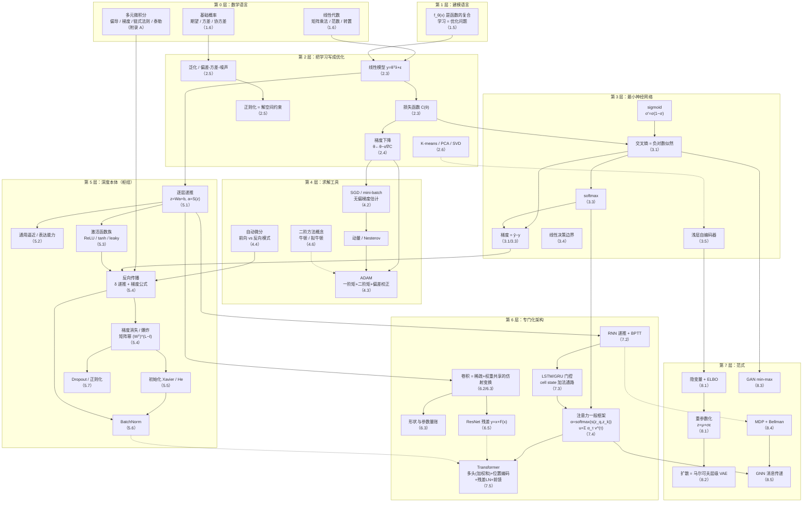

# 《深度学习的数学工程》概念依赖图与学习路径

> 配套文档：`拆书-深度学习的数学工程.md`（全局地图）、`breakdown/ch01–ch08.md`（逐章笔记）、`关键公式速查表.md`
> 用法：**先看依赖图定位自己卡在哪个节点，再照对应路径补齐前置**。本书的章节顺序是教学顺序，不等于依赖顺序——这份图的唯一目的就是把两者对齐。

---

## 第一部分　核心依赖图（概念级）

### 1.1 主干依赖（必须按箭头方向推进）

### 1.2 四条关键依赖链（背下来，用于诊断自己的卡点）

| 链        | 路径                                                                   | 断在哪里会怎样                 |
| -------- | -------------------------------------------------------------------- | ----------------------- |
| **可训练链** | 链式法则 → 反向传播 δ 递推 → 梯度消失/爆炸 → 初始化/BatchNorm/ReLU → ResNet/LSTM 的结构性解法 | 断了就只能"调参"，遇到不收敛束手无策     |
| **损失链**  | 概率/似然 → 负对数似然 → 交叉熵 → softmax 梯度 $\hat y-y$ → 各种多分类/序列模型             | 断了就分不清"换损失"和"换模型"的区别    |
| **优化链**  | 目标函数 $C(\theta)$ → 梯度无偏估计 → SGD → 动量 → ADAM → 学习率                    | 断了就只会照抄 `lr=1e-3`       |
| **结构链**  | 仿射变换 → 稀疏/共享约束 → 卷积 → 连接模式 → 注意力 → 图消息传递                             | 断了就理解不了"为什么换个连接方式就是新架构" |

### 1.3 前置关系表（"学 X 之前必须会 Y"）

| 要学的              | 硬前置                         | 软前置（不懂也能学，但会不透）    |
| ---------------- | --------------------------- | ------------------ |
| 2.3 线性模型         | 矩阵乘法、转置、偏导                  | 最小二乘的几何投影解释        |
| 2.4 梯度下降         | 梯度、链式法则                     | 凸性、收敛性             |
| 2.5 泛化与正则化       | 期望、方差                       | 岭回归的闭式解            |
| 2.6 PCA / SVD    | 协方差矩阵、特征值                   | 矩阵分解的几何意义          |
| 3.1 logistic 回归  | sigmoid、伯努利分布、最大似然          | GLM 理论             |
| 3.3 softmax      | 指数函数、归一化、交叉熵                | log-sum-exp 技巧     |
| 3.5 自编码器         | 3.1–3.3、重构损失                | PCA 子空间            |
| 4.3 ADAM         | 4.2（SGD、动量）、指数加权平均          | RMSProp / AdaGrad  |
| 4.4 自动微分         | **链式法则**、计算图                | 对偶数（dual number）实现 |
| 4.6 二阶方法         | Hessian、泰勒展开                | 拟牛顿的割线条件           |
| 5.4 反向传播         | 4.4 或附录 A.3、矩阵微分            | 计算图视角              |
| 5.5 初始化          | 5.4、随机变量方差的可加性              | 信号传播分析             |
| 5.6 BatchNorm    | 5.1、5.4、mini-batch 统计量      | 内部协变量偏移假说          |
| 6.2–6.3 卷积       | 5.1、仿射变换、张量形状               | 信号处理中的卷积           |
| 6.5 ResNet       | 5.4（梯度流）                    | 恒等映射的优化优势          |
| 7.2–7.3 RNN/LSTM | 5.4、BPTT                    | 门控的梯度分析            |
| 7.4 注意力          | 3.3 softmax、5.1             | 软寻址/信息检索类比         |
| 7.5 Transformer  | 7.4、5.6 LayerNorm、6.5 残差    | 位置编码的频域解释          |
| 8.1 VAE/ELBO     | 3.1 似然、KL 散度（附录 B.1）、4.4 反传 | 变分推断               |
| 8.2 扩散           | 8.1、高斯分布的性质（附录 B.2）         | 分数匹配 / SDE         |
| 8.3 GAN          | 3.1 交叉熵、博弈论基础               | 最优判别器              |
| 8.4 RL           | 条件期望、动态规划                   | 策略梯度定理             |
| 8.5 GNN          | 6.2 卷积、7.4 注意力              | 谱图理论               |

---

## 第二部分　可复用"乐高块"清单（比概念图更好用的一张表）

**读懂新论文的最快方式**：把它拆到这 12 块上，看它改了哪几块。

| # | 乐高块 | 数学形式 | 关键性质 | 出处 |
|---|---|---|---|---|
| 1 | 仿射变换 | $z=Wa+b$ | 线性、可反传 | 2.3 |
| 2 | sigmoid | $\sigma(z)=1/(1+e^{-z})$ | $\sigma'=\sigma(1-\sigma)$；饱和 | 3.1 |
| 3 | softmax | $\mathrm{softmax}(z)_i=e^{z_i}/\sum_j e^{z_j}$ | 平移不变；需数值稳定 | 3.3 |
| 4 | ReLU 族 | $\max(0,z)$ / leaky | 非饱和、分段线性 | 5.3 |
| 5 | 交叉熵 | $-\sum_i y_i\log\hat y_i$ | 等价于负对数似然；梯度 $\hat y-y$ | 3.1/3.3 |
| 6 | 平方误差 | $\|\hat y-y\|^2$ | 等价于高斯噪声下的 MLE | 2.3 |
| 7 | 反向传播 | $\delta^{[\ell]}=\mathrm{Diag}(S')\,(W^{[\ell+1]})^\top\delta^{[\ell+1]}$ | $O(\text{参数量})$ | 5.4 |
| 8 | 卷积 | 稀疏 + 权重共享的仿射变换 | 平移等变、参数量小 | 6.3 |
| 9 | 残差连接 | $y=x+F(x)$ | 恒等雅可比 ⇒ 梯度直通 | 6.5 |
| 10 | BatchNorm / LayerNorm | 标准化 + 仿射 $\gamma,\beta$ | 控制中间量分布 | 5.6 |
| 11 | 注意力 | $\mathrm{softmax}(QK^\top/\sqrt{d_k})V$ | 可微、无状态、可并行 | 7.4/7.5 |
| 12 | 重参数化 | $z=\mu+\sigma\odot\epsilon$ | 让采样可微 | 8.1 |

---

## 第三部分　三条学习路径

### 3.1 路径 A：建立骨架（2 周，目标：能手推一个两层的反向传播）

| 天 | 内容 | 通过标准 |
|---|---|---|
| D1 | 拆书主文档 + 本文件 | 能画出 1.1 的主干依赖图 |
| D2 | 1.5、1.6 + 附录 A | 能写出 $f_\theta$ 复合式与链式法则 |
| D3–4 | 2.3、2.4 | 能自己推最小二乘正规方程与 GD 更新式 |
| D5 | 2.5 | 能写出偏差-方差-噪声分解并解释三项 |
| D6–7 | 3.1、3.2 | **能推** 伯努利 MLE ⟹ 交叉熵；logistic 梯度 = $(\sigma-y)x$ |
| D8 | 3.3 | **能推** softmax+交叉熵梯度 = $\hat y-y$ |
| D9–10 | 4.2、4.3、4.4 | 能默写 ADAM（含偏差校正）；能说清前向/反向模式 |
| D11–13 | 5.1、5.3、5.4 | **手推两层网络完整反向传播**（不看书） |
| D14 | 5.4 矩阵幂 + 5.5 | 能解释梯度消失为何是矩阵幂问题；能推 Xavier 方差 |
| 验收 | 自测清单（各章） | 每章正确率 ≥ 70% |

### 3.2 路径 B：完整掌握（6–8 周）

在路径 A 基础上按 `2 全 → 3 全 → 4 全 → 5 全 → 6 全 → 7 全 → 8.1–8.3 → 8.4–8.5 → 附录 B` 推进。每周节奏：

- **周一–周三**：读原文（配 `_work/imgs/` 图片核公式）+ 写自己的推导
- **周四**：对照 `breakdown/chNN.md` 的"关键推导"，只补卡点
- **周五**：做该章"自测清单"
- **周六**：做本章"常见误区"，写出每一条的**反例**
- **周日**：间隔检索——合上书，画本章概念图 + 重推核心公式

### 3.3 路径 C：按目标定制（见下表）

| 目标 | 精读 | 略读/跳过 | 附加 |
|---|---|---|---|
| 接上 LLM / 大模型 | 1.5、2.3、2.4、3.1–3.3、4.2–4.4、5.1、5.4、7.4、7.5 | 6 全章、8.4–8.5 | 关注 7.5 的复杂度 $O(n^2)$，这是长上下文问题的起点 |
| 视觉 / CV | 2.3–2.5、3.1–3.3、5.1/5.3–5.7、6 全章 | 7.3（LSTM 细节）、8.4 | 6.3 的形状/参数量账要练到条件反射 |
| 生成模型 | 2.5、3.1、4.4、5.4、8.1–8.3、附录 B | 6、7.2–7.3、8.5 | 把 ELBO 与重参数化推到能默写 |
| RL / Agent | 2.3–2.5、4.1–4.3、5.4、8.4 | 6、7.4–7.5 细节 | 8.4 的 Bellman 方程要能自己推出来 |
| 图形/推荐 | 2.3、5.1/5.4、6.2–6.3、7.4、8.5 | 7.2–7.3、8.2–8.3 | 注意 GNN 与卷积、注意力的结构对应 |

---

## 第四部分　高杠杆节点详解（60% 时间投这里）

按"复用次数 × 阻塞程度"排序。**每个节点都给了"必须能不做参考地做到什么"**。

### ① 反向传播的完整递推（5.4）★★★★★
**必须能做到**：给定任意两层网络（前向含仿射 + 激活 + 损失），不看书写出 $\delta^{[L]}$、$\delta^{[\ell]}$ 的递推、$g_W^{[\ell]}$、$g_b^{[\ell]}$，并说清每一步用的是哪条链式法则。
**阻塞后果**：第 6–8 章全部只能背结论。

### ② 链式法则与自动微分的两种模式（4.4 + 附录 A.3）★★★★★
**必须能做到**：说清前向模式算的是"雅可比-向量积"、反向模式算的是"向量-雅可比积"，并解释为什么 $f:\mathbb{R}^n\to\mathbb{R}$ 时反向模式代价与 $n$ 无关。
**阻塞后果**：不理解"为什么深度学习能训"，也理解不了 VAE 为什么要重参数化。

### ③ 交叉熵 / 最大似然 / softmax 梯度（3.1、3.3 + 附录 B.1）★★★★★
**必须能做到**：从伯努利似然推出交叉熵；从 softmax 定义 + 交叉熵推出梯度 $=\hat y-y$；说清"换噪声假设就换损失"。
**阻塞后果**：分类问题的一切都变成黑箱。

### ④ 矩阵幂与梯度消失/爆炸（5.4 的 (5.34)(5.35)）★★★★★
**必须能做到**：写出前向 $\hat y=W^{[L]}W^{L-1}x$ 与反向 $\delta^{[\ell]}=(W^\top)^{L-\ell}\delta^{[L]}$，并解释"谱半径 ≠ 1 时必然消失或爆炸"。
**杠杆最高的地方**：它同时解释了 RNN 的问题（第 7 章）、ResNet 的动机（6.5）、LSTM cell state 的设计（7.3）、初始化的必要性（5.5）。**一个节点连带四章。**

### ⑤ 偏差-方差-噪声分解（2.5）★★★★
**必须能做到**：写出分解式，说清第三项为什么不可约，以及"训练时间变长 ≈ 模型复杂度变大"。
**阻塞后果**：无法判断"该加数据、该换模型、还是该早停"。

### ⑥ ADAM 的偏差校正（4.3）★★★★
**必须能做到**：默写完整 ADAM，并解释 $1-\beta_1^t$、$1-\beta_2^t$ 为什么必须存在（矩估计从 0 初始化导致初期有偏）。
**阻塞后果**：只会抄超参，遇到不收敛无法诊断。

### ⑦ 注意力的一般框架与缩放因子（7.4–7.5）★★★★
**必须能做到**：写出 $\alpha^{(t)}=S_{\text{softmax}}\big([s(z_q^{(t)},z_k^{(1)}),\dots]\big)$、$u^{(t)}=\sum_\tau\alpha^{(t)}_\tau v^{(\tau)}$，并说明 $s$ 是可任选的打分函数。
**方差论证（自行补的推导）**：设 $q,k$ 各分量独立零均值单位方差，推出 $q^\top k$ 方差为 $d$，除以 $\sqrt{d}$ 后方差恒为 1，故不缩放会使 softmax 饱和、梯度消失。
**⚠ 按原书表述**：书中把归一化写成 $\sqrt{\max(m_q,m_k)}$ 并定位为**数值稳定性因子**；多头合并是**加权和**，不是 concat。**这是"用概率论解释一个架构细节"的最佳范例**，也是理解所有"缩放"类设计的模板。

### ⑨ 位置编码为什么必需（7.5）★★★★
**必须能做到**：说清自注意力对输入序列是**置换等变**的（打乱输入顺序，输出只是同样被打乱），因此不注入位置信息模型就没有词序概念；写出正余弦编码 $r^{(t)}_{2i}=\sin(t/M^{2i/p_e})$、$r^{(t)}_{2i+1}=\cos(t/M^{2i/p_e})$。
**杠杆点**：这是"结构本身缺少某种对称性 ⟹ 必须显式补回"的思维模板。

### ⑧ ELBO 与重参数化（8.1）★★★★
**必须能做到**：从 $\log p(x)$ 推出 ELBO（用 Jensen 或 KL 分解两条路），并说清为什么必须重参数化才能反传。
**杠杆点**：它是"不可微怎么办"的范式级答案，也是扩散模型（8.2）的直接前置。

---

## 第五部分　概念锚点自测（合上书回答，答不出就回到对应节点）

1. 用一句话说清"数学工程"与"工程数学"的区别。（1.5）
2. 写出 $f_\theta(x)$ 的复合表达式，并指出 $\theta$ 由什么组成。（1.5）
3. 线性模型的最小二乘解是什么？它在什么条件下不可用，怎么补救？（2.3）
4. 写出偏差-方差-噪声分解，并指出哪一项不可约。（2.5）
5. 为什么说"正则化是对解空间的约束"？用岭回归的 $+\lambda I$ 说明。（2.5）
6. 从伯努利最大似然推出交叉熵损失。（3.1）
7. 写出 softmax + 交叉熵的梯度，并解释为什么形式这么简单。（3.3）
8. 说清前向模式与反向模式自动微分的区别，以及深度学习为什么用后者。（4.4）
9. 写出 ADAM 的完整更新式，并解释偏差校正的必要性。（4.3）
10. 为什么零初始化会让网络失效？它损失的是什么？（5.5）
11. 写出反向传播的 $\delta$ 递推式与两个梯度公式。（5.4）
12. 为什么说梯度消失的根源是矩阵幂而不是 sigmoid？（5.4）
13. 卷积层的参数量为什么与输入图像尺寸无关？（6.3）
14. 残差连接为什么能改善梯度流？写出其雅可比。（6.5）
15. LSTM 的 cell state 为什么被称为"梯度高速公路"？（7.3）
16. 写出注意力的一般框架（权重与上下文向量），并说明打分函数 $s$ 与归一化因子的作用。（7.4–7.5）
17. 为什么自注意力必须配位置编码？写出正余弦编码并说明它编码了什么。（7.5）
17b. 本书的多头合并方式和主流教材有什么不同？为什么这个差异容易被误"纠正"？（7.5）
18. 写出 ELBO 的两种分解形式。（8.1）
19. 重参数化技巧解决的是什么问题？（8.1）
20. 为什么说扩散模型是 VAE 的特例？（8.2）
21. RL 与监督学习的数学差别在哪三点？（8.4）
22. GNN 的聚合操作为什么通常用求和/均值/最大值？（8.5）

> **建议**：把这份清单做成 Anki 卡片。当天学完后第 1、3、7、14 天各答一次。**能全部答出 = 这本书的骨架已经是你自己的了。**
