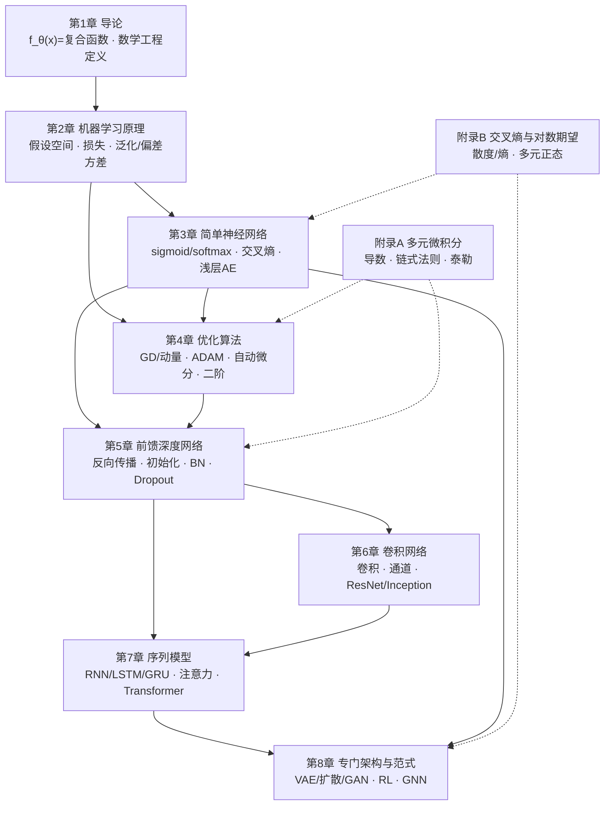

# 《深度学习的数学工程》拆书

> **原书**：*Mathematical Engineering of Deep Learning*，Benoit Liquet、Sarat Moka、Yoni Nazarathy 著（Macquarie University / UNSW / University of Queensland）
> **中文版**：《深度学习的数学工程：模型背后的数学原理》，王斌 译，人民邮电出版社，2026-06，360 页，定价 99.8 元
> **英文原书**：8 章 + 2 个附录，Book Draft（2024-02-28），官方站点 <https://deeplearningmath.org/> 免费提供各章 PDF
> **来源说明**：本拆书基于官方公开的 Book Draft 全文（已下载 8 章 + 附录 A/B + 后记，共 393 页）逐页核对撰写，所有公式与数字均可回原文定位。
> **拆书日期**：2026-10-15　逐章精读笔记见 `breakdown/` 目录。

---

## 第一部分　这本书到底在讲什么

### 1.1 一句话概括

> **把深度神经网络严格定义为"仿射变换与非线性激活的交替复合函数"，把"学习"严格定义为"对这个复合函数的参数求解一个优化问题"；于是整个深度学习就变成一门可以用线性代数、多元微积分和基础概率把每一块都写清楚、算清楚、拼起来的数学工程。**

这不是一本调包手册，也不是一本理论论文集，而是**第三条道路**：它不教你怎么跑代码，而是教你**为什么这样设计**。作者在序言里把自己的立场说得非常直白——多数深度学习资料要么"努力把数学藏起来"，要么"追求理论结果却不澄清术语"，要么"沉迷历史脉络"；对数学背景的读者，这三种都是次优的学习方式。所以他们**刻意砍掉**了三样东西：

| 被砍掉的 | 作者的判断 |
|---|---|
| 生物神经科学类比 | 人工神经网络与真实神经元的类比是"松散的"，初期花太多时间会错过深度学习的简洁性 |
| 历史演进脉络 | 只讲当前 state of the art，不讲它是怎么演化来的 |
| 实现/工程细节 | 不涉及框架使用、性能调优等实践层面 |

**全书自始至终只有一个视角**（第 1.5 节正式命名）：

$$a^{[\ell-1]}\;\xrightarrow[\text{Affine Transformation}]{z^{[\ell]}:=W^{[\ell]}a^{[\ell-1]}+b^{[\ell]}}\;z^{[\ell]}\;\xrightarrow[\text{Activation}]{a^{[\ell]}:=S^{[\ell]}(z^{[\ell]})}\;a^{[\ell]}$$

单层 $f^{[\ell]}_{\theta^{[\ell]}}$ 由**仿射变换 + 非线性激活**组成，可训练参数 $\theta^{[\ell]}=\{W^{[\ell]},b^{[\ell]}\}$；整个深度网络是 $L$ 层的**函数复合**：

$$y=f_\theta(x)=f^{[L]}_{\theta^{[L]}}\Big(f^{[L-1]}_{\theta^{[L-1]}}\big(\cdots f^{[1]}_{\theta^{[1]}}(x)\cdots\big)\Big),\qquad x=a^{[0]},\;y=a^{[L]}$$

### 1.2 书名里的关键词：为什么是"数学工程"而不是"工程数学"

这是全书最需要先搞懂的一个概念区分，作者用了一组类比来讲：

| 领域 | 被工程化的对象 | 学科名 |
|---|---|---|
| 电路设计 | 电的流动 | electrical engineering |
| 机械臂设计 | 力学 | mechanical engineering |
| **深度网络设计** | **数据在仿射函数、非线性函数组合中的流动** | **mathematical engineering** |

> "工程数学"（engineering mathematics）是指用数学工具去设计**物理**系统；而"数学工程"是指**数学本身就是被设计的那件东西**。设计一个深度网络，做的事情就是规定数据经过哪些仿射变换、哪些非线性函数、以及它们的维度与稀疏结构——这**本身就是数学规格说明**。

作者由此给出"数学工程"的全部工作清单，这是全书 8 章的总纲：

1. **选非线性函数** $S^{[\ell]}(\cdot)$（→ 第 3、5 章）
2. **定维度**：$W^{[\ell]}$、$b^{[\ell]}$ 的形状（→ 第 5、6、7 章）
3. **定稀疏结构**：例如卷积的权重共享、注意力的连接模式（→ 第 6、7 章）
4. **定优化目标**：即 loss function（→ 第 2、3 章）
5. **定优化算法**：迭代求解 $\theta$（→ 第 4 章）
6. **定训练策略**：初始化、归一化、正则化（→ 第 5 章）

### 1.3 作者的一个"反高潮"结论（务必读进心里）

后记（Epilogue）里作者给了一个非常清醒的判断，它决定了你应该用什么样的期待来读这本书：

> **这些模型之所以流行和成功，是因为它们的实际可用性（practical applicability），而不是因为数学上的优雅（mathematical elegance）。**

作者拿 Transformer 举例：这个架构"相当任意（quite arbitrary）"，如果在 2017 年论文发表之前把这个架构拿给他们看，而**没有实证实验结果**，他们没有任何证据能证明它会工作得这么好。

> **数学工程很重要，但"没有计算机、GPU、软件、数据和实验，它就是没有实体的（void of substance）"。**

**这是本书最重要的一条元认知**：本书给你的是"每个模块的数学规格与代价"，不是"为什么这个架构一定好"。凡是"为什么这个设计好"的问题，本书的答案本质上都是"因为它被实验验证了"。

### 1.4 本书的数学门槛（作者的自我声明）

作者明确声明：**深度学习虽然"深"，但用到的数学相当"浅"**。

| 数学分支 | 本书真正需要的 | 明确声明**不需要**的 |
|---|---|---|
| 线性代数 | 矩阵乘法、范数、少量基本运算 | 向量空间、特征值、矩阵分解（**基本不需要**） |
| 微积分 | 导数及其多变量版本、链式法则 | 积分、向量场、流形、实函数性质（**基本不用**） |
| 概率 | 基础概率、期望、方差、协方差 | 高等概率论 |
| 优化 | 第 4 章自包含讲解 | 无需预备知识（附录 A 补多元微积分） |

结论：**本科一、二年级工科数学水平即可通读**。全书把真正重要的推导都放在正文里自包含地讲完。

### 1.5 与同类书的定位差异

| 书 | 主线 | 本书与它的关系 |
|---|---|---|
| 《Deep Learning》(Goodfellow 等) | 综合教材，含大量历史与神经科学 | 本书刻意避开历史与生物类比 |
| 《Deep Learning for Coders with fast.ai and PyTorch》 | 代码驱动 | 互补：本书讲"为什么"，那本讲"怎么做" |
| 《Probabilistic Machine Learning》(Murphy) | 概率视角的完整理论体系 | 本书轻量得多：只用基础概率，不进入理论结果 |
| 各类论文 | 前沿结果 | 本书给的是"读懂论文所需的记号与拼装规则" |

---

## 第二部分　全书骨架：一张图、四根线、五个模块

### 2.1 问题树：这本书在回答哪些问题

```
根问题：一个"高维参数 + 高维输入"的函数逼近问题，如何在数学上把它写清楚、拆成模块、并使它可训练？

├─ Q0 定义：什么是深度学习模型？（第 1 章）
│   └─ f_θ(x) = 函数的复合；θ、x 高维，y 低维
│
├─ Q1 学习是什么？（第 2 章）
│   ├─ 定义假设空间（线性模型 → 深度网络）
│   ├─ 定义损失函数（最小二乘 / 绝对误差 / Huber / 0-1 …）
│   ├─ 把学习写成优化问题：min_θ C(θ)
│   └─ 泛化：为什么"训练误差低"不等于"模型好"？（偏差-方差-噪声分解）
│
├─ Q2 最基本的非线性模块是什么？（第 3 章）
│   ├─ logistic 回归 = 统计 GLM = 单神经元 + sigmoid + 交叉熵
│   ├─ softmax 回归 = 多分类的多神经元推广
│   └─ 浅层自编码器 = 编码器-解码器 + 重构损失
│
├─ Q3 怎么把这个优化问题真的解出来？（第 4 章）
│   ├─ 一阶方法：梯度下降、动量、SGD、mini-batch
│   ├─ 自适应方法：AdaGrad → RMSProp → ADAM（含偏差校正）
│   ├─ 梯度从哪来：自动微分（前向模式 vs 反向模式）
│   └─ 二阶概念：牛顿法、拟牛顿、Gauss-Newton（为什么深度学习少用）
│
├─ Q4 深（多层复合）带来什么？（第 5 章｜全书心脏）
│   ├─ 结构：逐层递推、参数量
│   ├─ 能力：通用逼近定理、深度 vs 宽度
│   ├─ 梯度：反向传播 = 链式法则的 O(参数量) 组织方式
│   ├─ 病态：梯度消失 / 爆炸（矩阵幂分析）
│   └─ 对策：初始化（Xavier/He）、BatchNorm、Dropout、正则化
│
├─ Q5 空间/图像数据怎么处理？（第 6 章）
│   └─ 卷积 = 带权重共享和平移等变性的稀疏仿射变换
│
├─ Q6 序列数据怎么处理？（第 7 章）
│   ├─ 有状态：RNN → LSTM / GRU（门控 vs 梯度流）
│   ├─ 编码器-解码器 + 注意力（软寻址）
│   └─ Transformer = 自注意力 + 位置编码 + 残差/归一化 + 前馈
│
└─ Q7 还有哪些范式？（第 8 章）
    ├─ 生成：VAE（ELBO/重参数化）→ 扩散模型 → GAN
    ├─ 决策：RL（MDP / Bellman / 深度 RL）
    └─ 关系：GNN（消息传递 / 聚合）
```

### 2.2 四根贯穿全书的线（每一章都在用的暗线）

这四条线是本书真正的"世界观"。**如果只记四句话，就记这四句**：

1. **复合线**：一切模型都是 $f_\theta$ 的复合。
   第 3 章是"1 层"，第 5 章是"$L$ 层"，第 6 章给复合中的一层换了"带权重共享的仿射变换"，第 7 章换了"带注意力的复合"，第 8 章则把复合函数**配上概率结构**（VAE/扩散）或**配上决策结构**（RL）。**判断一个新架构，第一步永远是问："它在复合链里插入了什么模块？"**

2. **优化线**：一切学习都是 $\min_\theta C(\theta)$。
   第 2 章建立框架，第 3 章给出第一个具体损失（交叉熵），第 4 章给出求解算法（ADAM），第 5 章解释为什么深网络难解（梯度消失/爆炸），第 8 章则出现"目标函数本身带对抗"（GAN）或"目标函数是期望回报"（RL）的变体。**正则化在这个视角下就是"对解空间的约束"**（第 2 章原话），而不是什么防过拟合的玄学技巧。

3. **链式法则线**：一切都是链式法则的高效组织。
   反向传播（第 5 章）与自动微分（第 4 章）是同一件事的两种叙述：前者按层手写递推，后者用计算图自动完成。**"能不能反传"甚至决定了架构设计**——VAE 的重参数化技巧 $z=\mu+\sigma\odot\epsilon$ 存在的唯一理由就是"让采样这一步变得可微"。

4. **代价线**：每个设计选择都有数学代价。
   参数量（第 1 章 VGG19 的 1.44 亿）、计算量、显存、数值稳定性（sigmoid 饱和、softmax 溢出、梯度爆炸）、以及训练所需数据量。**本书最"工程"的地方就在这里：它不断告诉你每个模块"要花多少"。**

### 2.3 六个核心数学对象（全书只有这六块乐高）

| # | 数学对象 | 形式 | 首次出现 | 全场复用 |
|---|---|---|---|---|
| 1 | **仿射变换** | $z=W a+b$ | 2.3 线性模型 | 每一层、每一个模块 |
| 2 | **逐元素非线性激活** | $a=S(z)$：sigmoid / tanh / ReLU / softmax | 第 3 章 | 第 3、5–8 章 |
| 3 | **损失函数** | $C(\theta)$：平方误差 / 交叉熵 / 重构误差 / ELBO / 对抗损失 | 2.3 | 全书 |
| 4 | **复合 + 链式法则** | $f=f^{[L]}\circ\cdots\circ f^{[1]}$；反向传播、自动微分 | 1.5 / 5.4 | 第 4–8 章 |
| 5 | **概率结构** | 似然、期望、方差、KL、ELBO、MDP | 第 2 章（最大似然） | 第 3、8 章 |
| 6 | **结构约束** | 权重共享（卷积）、连接模式（注意力/图）、随机性（Dropout/采样） | 第 5–8 章 | 第 6–8 章 |

> **一个非常实用的判断**：读任何新模型，只要回答"它改的是这六块里的哪一块"就够了。例如 BatchNorm 改的是**模块 1 与 2 之间的中间量分布**；ResNet 改的是**模块 4 的复合方式**（加了一条恒等通路）；GAN 改的是**模块 3**（损失变成 min-max）。

### 2.4 全书的"数学工程六步法"（把这本书用起来的方式）

作者散落在各章的工程流程，可以整理成一张固定动作表。**设计任何一个新模型时，照着走一遍**：

| 步骤         | 问什么                                    | 产出                                    | 主要章节                  |
| ---------- | -------------------------------------- | ------------------------------------- | --------------------- |
| ① 定复合结构    | 输入 $x$ 是什么形状？输出 $y$ 是什么形状？中间放哪些层？      | 逐层递推式 + 张量形状链                         | 5.1 / 6.3 / 7.5       |
| ② 数参数量与计算量 | $W^{[\ell]}$、$b^{[\ell]}$ 各多少元素？乘法多少次？ | 参数/FLOPs 的显式表达式                       | 1.1（VGG19）、6.3        |
| ③ 选损失函数    | 任务是回归、二分类、多分类、生成还是决策？                  | $C(\theta)$ 的具体形式                     | 2.3 / 3.1 / 3.3 / 8.1 |
| ④ 求梯度      | 能否写出 $\nabla_\theta C$？哪一步不可微？         | 反向递推式，或"必须重参数化"的结论                    | 4.4 / 5.4 / 8.1       |
| ⑤ 选优化器与超参  | 用 SGD 还是 ADAM？学习率多少？                   | 递推更新式                                 | 4.2 / 4.3             |
| ⑥ 保证可训练    | 初始化怎么做？要不要归一化/正则化/裁剪？                  | Xavier/He、BatchNorm、Dropout、$L_1/L_2$ | 5.5 / 5.6 / 5.7       |

> **第 ④ 步是从"看懂"到"会设计"的分水岭**。本书反复出现同一个套路：先写出前向，再问"这一步对参数可微吗"，不可微就想办法换一种等价写法（重参数化、softmax 的 log-sum-exp、ReLU 的次梯度）。

### 2.5 八个模块的依赖图



**读图要点**：
- **第 5 章是唯一的"枢纽"**：它同时依赖第 3 章（损失）与第 4 章（优化），又被第 6、7 章依赖。**第 5 章没过关，后面都是背名词。**
- **第 7 章是通往当今 LLM 的唯一路径**：Transformer 在 7.5 节。想快速接上 LLM，最短路径是 `2.3/2.4 → 3.1–3.3 → 4.2/4.3 → 5.1/5.4 → 7.4/7.5`。
- **第 8 章是"组合式复习"**：VAE、扩散、GAN、RL、GNN 都没有引入新的基础乐高块，全是第 2–7 章的重新拼装。所以第 8 章学得吃力的真实原因，通常是前面某块没打牢。

### 2.6 八个模块的分组

全书 8 章可以按"抽象层级"分成**五个模块**：

| 模块 | 章 | 主题 | 一句话定位 |
|---|---|---|---|
| **模块 I 数学语言** | 1 | 导论 | 定调：模型 = 函数复合，学习 = 优化 |
| **模块 II 学习的一般理论** | 2 | 机器学习原理 | 把"学习"写成优化问题，并解释泛化 |
| **模块 III 最小可用的神经网络** | 3–4 | 简单网络 + 优化算法 | 先造出最小的乐高块，再配齐求解工具 |
| **模块 IV 深度网络本体** | 5 | 前馈深度网络 | 全书心脏：复合、反传、可训练性 |
| **模块 V 专门化架构与范式** | 6–8 | 卷积 / 序列与注意力 / 生成·RL·图 | 把乐高块拼成真实系统 |

---

## 第三部分　八章逐章地图

> 每章给出：核心问题 → 关键数学对象 → 必须记住的结论。详细笔记见 `breakdown/chNN.md`。

### 第 1 章　Introduction（导论）
- **核心问题**：深度学习到底是什么？把它当"数学工程"看意味着什么？
- **关键对象**：$f_\theta(x)$（高维 $x$、高维 $\theta$、低维 $y$）；任务族（分类、回归、定位、语义分割）；数据集（ImageNet、MNIST、Fruits 360）；记号约定（列向量、$\|u\|=\sqrt{u^\top u}$、$I=\sum_i e_ie_i^\top$）。
- **必记结论**：
  - 深度学习 ≠ 新数学：只用线性代数 + 多元微积分 + 基础概率，**且只用到其中最基础的部分**。
  - 驱动这场革命的四要素：**大规模标注数据 + GPU 算力 + 开源软件生态 + 互联网协作**。四者缺一不可。
  - **Figure 1.1 是全书唯一一段代码**（fast.ai 迁移学习 VGG19 识别香蕉）——作者用它明确宣告"这本书不讲代码"。
  - 迁移学习（fine-tuning）：用 ImageNet 预训练的 VGG19，在 Fruits 360 上微调只需约 10 分钟（GPU），而从零训练要数小时。

### 第 2 章　Principles of Machine Learning（机器学习原理）
- **核心问题**：怎么把"从数据中学习"这件事**严格**写成一个优化问题？又怎么解释它为什么能泛化？
- **关键对象**：特征/标签 $(x,y)$、训练/验证/测试集、线性模型 $y=b+w^\top x+\epsilon$ 及其紧凑形式 $y=\theta^\top\tilde x+\epsilon$、设计矩阵 $X$、损失函数（平方误差、绝对误差、Huber、0-1）、经验风险 $C(\theta)=\sum_i C_i(\theta)$、正则化项 $R_\lambda(\theta)$。
- **必记结论（本章是全书"含金量最高"的公式集中地）**：
  - **最小二乘的闭式解**：正规方程 $X^\top X\theta=X^\top y$ ⟹ $\hat\theta=(X^\top X)^{-1}X^\top y$；用 SVD 表示伪逆 $X^\dagger=V\Sigma^+U^\top$ 处理不可逆/病态情形。
  - **梯度下降更新式**：$\theta^{(t+1)}=\theta^{(t)}-\alpha\nabla C(\theta^{(t)})$；线性模型下 $\nabla C=2X^\top(X\theta-y)$。
  - **偏差-方差-噪声分解**（在平方误差 + $y=f(x)+\epsilon,\ \mathbb{E}[\epsilon]=0$ 下）：
    $$\mathbb{E}_{\text{unseen}}=\underbrace{\big(\mathbb{E}[\hat f(x')]-\mathbb{E}[f(x')]\big)^2}_{\text{Bias}^2}+\underbrace{\mathrm{Var}\big(\hat f(x';D)\big)}_{\text{Variance}}+\underbrace{\mathbb{E}[\epsilon^2]}_{\text{Inherent Noise}}$$
    **欠拟合 = 高偏差，过拟合 = 高方差**。注意第三项不可约——它是问题的下界。
  - **正则化 = 对解空间的约束**：$\min_\theta C(\theta;D)+R_\lambda(\theta)$；岭回归给出 $\hat\theta=(X^\top X+\lambda I)^{-1}X^\top y$——$+\lambda I$ 同时改善数值条件。
  - **验证集的作用**：先用验证集选超参 $\lambda^*$，**测试集只能用一次**。
  - 无监督：K-means 的目标 $\min\sum_{x\in C_k}\|x-\mu_k\|^2$（交替两步，只保证局部最优）；PCA 是"在 $\|v\|=1$ 约束下最大化 $v^\top Sv$"，解为样本协方差矩阵的特征向量，与 SVD 等价（第 2.6 节把 (2.42)–(2.53) 一路推通了 PCA↔SVD）。

### 第 3 章　Simple Neural Networks（简单神经网络）
- **核心问题**：最小的神经网络长什么样？它和传统统计模型是什么关系？
- **关键对象**：logistic 回归（sigmoid + 伯努利似然）、softmax 回归（多分类）、交叉熵损失、决策边界、浅层自编码器。
- **必记结论**：
  - **一个模型、两种身份**：logistic 回归既是统计学的 GLM（用最大似然导出），又是"单神经元 + sigmoid + 交叉熵"的神经网络。**最大似然 ≡ 最小化交叉熵**——这是本书把统计与深度学习缝合起来的关键一针。
  - sigmoid 的导数性质 $\sigma'=\sigma(1-\sigma)$ 是反向传播能写得这么简洁的根源。
  - **softmax + 交叉熵的梯度是 $\hat y-y$**——这个"预测减真值"的极简形式，是全书所有梯度推导的模板。
  - **决策边界**：logistic 的边界是线性的；要靠隐藏层/特征变换才能超越线性（3.4 节）。
  - 浅层自编码器：编码器-解码器 + 重构损失 + 瓶颈层；线性自编码器学到的是 PCA 张成的子空间。

### 第 4 章　Optimization Algorithms（优化算法）
- **核心问题**：$C(\theta)$ 写出来了，怎么真的把它解出来？
- **关键对象**：优化问题标准形式、凸性、一阶/二阶最优性条件、SGD / mini-batch、动量、**ADAM**、**自动微分**、牛顿法与拟牛顿法。
- **必记结论**：
  - **为什么必须随机**：参数量巨大 ⟹ 全量梯度每步代价不可承受；mini-batch 梯度是无偏估计（$\mathbb{E}[\hat g]=g$），用方差换取步数。
  - **ADAM = 动量 + RMSProp + 偏差校正**。偏差校正项 $1-\beta^t$ 的存在理由：一阶/二阶矩估计从 $0$ 初始化，训练初期被系统性地压小，必须除以 $1-\beta^t$ 才能无偏。
  - **自动微分的两种模式**：前向模式传播**雅可比-向量积**，反向模式传播**向量-雅可比积**。对 $f:\mathbb{R}^n\to\mathbb{R}$，**反向模式的代价与 $n$ 无关**——这正是深度学习（参数极多、输出是标量损失）必须用反向模式的数学理由。
  - 二阶方法概念：牛顿法用 Hessian 修正方向与尺度，收敛快但每步 $O(n^2)$ 存储 / $O(n^3)$ 求解，深度学习规模下不可行——**这才是它被一阶方法取代的原因，而不是"一阶更好"**。

### 第 5 章　Feedforward Deep Networks（前馈深度网络）★全书心脏
- **核心问题**：把层数加深之后，模型获得了什么能力？又付出了什么代价？怎么才能训得动？
- **关键对象**：逐层递推 $z^{[\ell]}=W^{[\ell]}a^{[\ell-1]}+b^{[\ell]}$、$a^{[\ell]}=S^{[\ell]}(z^{[\ell]})$；通用逼近定理；激活函数族；**反向传播**；权重初始化；BatchNorm；Dropout。
- **必记结论**：
  - **反向传播不是优化算法，而是"求梯度的算法"**——它把链式法则组织成 $O(\text{参数量})$ 的代价，而不是朴素地对每个参数各算一次。
  - **梯度消失/爆炸的本质是矩阵幂**。作者用简化例子给出：前向 $\hat y=W^{[L]}W^{L-1}x$；反向 $\delta^{[\ell]}=(W^\top)^{L-\ell}\delta^{[L]}$。除非 $W$ 的谱半径恰好为 1，$L$ 一大就必然消失或爆炸。**这不是激活函数的锅，是反复矩阵乘法本身的性质**——所以换 ReLU 只能缓解，不能根治。
  - **对策链条**：ReLU 类激活（缓解饱和）→ 合适的初始化（Xavier/He，控制各层方差）→ 归一化（BatchNorm，控制中间量分布）→ 梯度裁剪（应付爆炸）。**注意梯度裁剪的两种做法有本质区别**：逐坐标裁剪会改变梯度方向，按范数缩放则保持方向。
  - **零/常数初始化会破坏对称性**：所有隐藏单元学到同样的东西，网络退化成"一个大神经元"，表达力被浪费。随机初始化是必须的。
  - **Dropout**：训练时随机置零、推理时缩放；**BatchNorm** 在训练与推理阶段行为不同（推理用滑动平均统计量）——这两条是实践中出错最多的地方。

### 第 6 章　Convolutional Neural Networks（卷积神经网络）
- **核心问题**：图像（空间）数据怎么用数学工程的方式利用"局部性"和"平移不变性"？
- **关键对象**：卷积（互相关）运算、通道 $(H,W,C)$、卷积核 $(k_h,k_w,C_{in},C_{out})$、步长 $s$、填充 $p$、池化、1×1 卷积、Inception 模块、ResNet 残差连接。
- **必记结论**：
  - **卷积层 = 稀疏 + 权重共享的仿射变换**。这两条一起，把全连接层的参数量按图像尺寸的平方级压到只与核大小和通道数有关（这是 CNN 效率的**全部**来源）。
  - **平移等变性**是卷积结构的直接数学后果。
  - 输出尺寸与参数量的显式公式必须会算（见 `breakdown/ch06.md` 的"形状与算力账"一节）：给定任意输入形状，能立刻算出输出形状、参数量、计算量。
  - **ResNet 的残差连接 $y=x+F(x)$** 从梯度角度看：反向时恒等通路的雅可比是 $I$，梯度可以直接流回浅层——**这是"用结构解决优化问题"的最典型例子**。
  - 里程碑架构演进（AlexNet → VGG → Inception → ResNet）讲的是"如何在深度增加时保持可训练性与参数效率"。

### 第 7 章　Sequence Models（序列模型）
- **核心问题**：长度可变、有顺序依赖的数据怎么建模？注意力为什么能取代循环结构？
- **关键对象**：序列建模目标（下一 token 预测）、嵌入、RNN 递推、BPTT、LSTM/GRU 门控、编码器-解码器、**注意力机制**、**Transformer**（自注意力、多头、位置编码、残差+LayerNorm、位置前馈）。
- **必记结论**：
  - **RNN 的根本矛盾**：同一个 $W$ 沿时间反复相乘 ⟹ 梯度消失/爆炸（与第 5 章同源）；且**时间步必须串行**，无法并行。
  - **LSTM 的 cell state 是一条"加法式"的梯度高速公路**——遗忘门让梯度可以近乎无损地穿越很多时间步。这是"用结构改善梯度流"的第二个典型例子（第一个是 ResNet）。
  - **注意力的本质是"用查询与键的相似度做软寻址，再加权求和值"**：书中给出的**一般框架**是
    $$\alpha^{(t)}=S_{\text{softmax}}\Big(\big[s(z_q^{(t)},z_k^{(1)}),\dots,s(z_q^{(t)},z_k^{(T_{\text{in}})})\big]^\top\Big),\qquad u^{(t)}=\sum_{\tau}\alpha^{(t)}_\tau v^{(\tau)}$$
    其中 $z_q$ 是 query 代理向量、$z_k$ 是 key 代理向量、$v$ 是 value。它是**可微的、无状态的、可并行的**——这三点一起解释了它为什么取代了 RNN。
  - **⚠ 与主流表述的重要差异（照原文，不要"纠正"）**：本书**没有**写出 $\mathrm{softmax}(QK^\top/\sqrt{d_k})V$ 这个形式化式子，而是把它当作上述一般框架的一个实例化；维度记号用 $m_q,m_k,m_v,p$（不是 $d_k,d_v,d_{\text{model}}$）；**多头合并是加权和** $u^{(t)}=\sum_{h=1}^H W^h_c u^{h,(t)}$，**不是 concat + 投影**。
  - **缩放因子的原文表述**：打分函数"typically have normalization as part of the score function with a factor such as $\sqrt{\max(m_q,m_k)}$… maintains score values at a reasonable range for numerical stability"（p274）。也就是说，本书把它定位为**数值稳定性归一化因子**。其方差解释为：若 $q,k$ 各分量独立、零均值、单位方差，则点积 $q^\top k$ 的方差为 $d$，除以 $\sqrt{d}$ 后方差恒为 1，避免 softmax 饱和与注意力退化。**这是"用概率论解释架构细节"的标准范例。**
  - **位置编码的存在理由是结构性的**：自注意力对输入顺序是置换等变的，**不注入位置信息，Transformer 就完全不知道词序**。书中给出两条路：可学习位置编码 (7.28) 与正余弦位置编码 (7.29) $r^{(t)}_{2i}=\sin(t/M^{2i/p_e})$、$r^{(t)}_{2i+1}=\cos(t/M^{2i/p_e})$，$M=10{,}000$。
  - **Transformer 的范式转变是"放弃递归、改为并行"**：时间 $t$ 不再是计算的一步，而只是输入矩阵 $X\in\mathbb{R}^{p\times T}$ 的一个维度。**但书中明确指出它退回了定长输入输出**（需要 `<empty>` 填充）——变长能力本来是 RNN 的强项，Transformer 真正换来的是并行性。
  - 复杂度：注意力权重矩阵是 $T\times T$（书中以 $T_{\text{in}}$ 维 softmax 权重体现），这是后面所有长上下文工作的出发点。
  - **可核对的参数量**：单块参数量 $=4p+2N_1p+N_1+p+H(2mp+2m_vp)$；$p=512,N_1=2048,m=m_v=64,H=8$ 时为 **3,150,336**；解码器块 4,199,936；6+6 编码器-解码器约 63M。

### 第 8 章　Specialized Architectures and Paradigms（专门架构与范式）
- **核心问题**：前七章的基础乐高块，如何重新组合出"生成"、"决策"、"关系建模"三类完全不同的任务？
- **关键对象**：
  - **生成**：隐变量模型、ELBO、重参数化技巧 $z=\mu+\sigma\odot\epsilon$、扩散模型（前向加噪 / 反向去噪）、GAN 的 min-max 目标
  - **决策**：MDP $(S,A,P,R,\gamma)$、回报、价值函数 $V^\pi,Q^\pi$、Bellman 方程、Q-learning、深度 RL
  - **关系**：图的邻接矩阵/度矩阵、消息传递与聚合、图卷积、读出层
- **必记结论**：
  - **ELBO 是"因为真似然不可解而被迫引入的替代目标"**：$\log p(x)\ge \mathbb{E}_{q}[\log p(x|z)]-\mathrm{KL}(q(z|x)\|p(z))$。它不是新原理，是第 2 章"定义损失函数"的老套路的概率版。
  - **重参数化技巧的唯一目的：让采样可反传**。$z\sim\mathcal N(\mu,\sigma^2)$ 这一步本身不可微；写成 $z=\mu+\sigma\odot\epsilon,\ \epsilon\sim\mathcal N(0,I)$ 后，随机性被移到与参数无关的 $\epsilon$ 上，梯度就能穿过 $\mu,\sigma$。**这是"链式法则线"决定架构设计的最佳例证。**
  - **⚠ 但扩散模型里的"重参数化"目的不同**：扩散的编码器按定义**没有可学参数** $\phi$（前向加噪核 $q(z_{t+1}|z_t)$ 完全给定），所以不存在"梯度传不过去"的问题。那里的重参数化 $z_t^*=\sqrt{\gamma_t}x+\sqrt{1-\gamma_t}\epsilon_t^*$ 的真正作用是把网络的任务从"预测均值 $\mu_{\theta_t}$"换成"**预测噪声** $\hat\mu_{\theta_t}$"，从而把损失化简成干净的噪声回归 (8.41)。**把两处重参数化当成同一件事，就看不出扩散模型的损失为什么能写得这么简洁。**
  - **扩散模型不是全新物种**：作者明确把它定位为"马尔可夫层级变分自编码器"（Markovian hierarchical VAE）的特例。前向过程有闭式解 $q(x_t|x_0)$，$\bar\alpha_t=\prod_{i\le t}\alpha_i$；训练目标可以简化成"预测所加噪声"。
  - **GAN 的目标函数本身就是对抗的**：$\min_G\max_D$，这是本书唯一一个"目标函数不是单一最小化"的模块，也是训练不稳定的数学根源。
  - **RL 与监督学习的根本区别**：没有给定标签 $y$，只有延迟的、稀疏的标量奖励；Bellman 方程把"长期回报"递归地分解成"即时奖励 + 折扣后的下一状态价值"，**这是把序列决策问题变成可迭代求解的关键一步**。
  - **GNN 是"在图上做消息传递"**：每个节点聚合邻居特征再变换，置换等变性由聚合操作（求和/均值/最大值）保证。

---

## 第四部分　概念依赖图与学习路径（详见 `概念依赖图与学习路径.md`）

### 4.1 三档学习目标

| 档位 | 目标 | 覆盖章节 | 时间 |
|---|---|---|---|
| **A 建立骨架** | 能说清"模型=复合函数、学习=优化问题"，能手写前向与反向 | 1、2.3–2.4、3.1–3.3、4.2–4.3、5.1、5.4 | 2 周 |
| **B 完整掌握** | 全书 8 章推导都能自己走一遍，能算参数量/复杂度 | 全部 8 章 + 附录 A/B | 6–8 周 |
| **C 用于研究** | 能读新论文并把它映射到"六块乐高"上，能判断设计改动的代价 | 全部 + 每章 Notes and References 里的原始论文 | 持续 |

### 4.2 高杠杆节点（60% 时间应投在这里）

按"复用次数 × 阻塞程度"排序：

1. **反向传播的完整递推**（5.4）——不推通这一遍，后面全是背名词
2. **链式法则与自动微分的两种模式**（4.4 + 附录 A.3）
3. **交叉熵 / 最大似然 / softmax 梯度 $\hat y-y$**（3.1、3.3 + 附录 B.1）
4. **矩阵幂与梯度消失/爆炸**（5.4 的 (5.34)(5.35)）——它同时解释了 RNN、ResNet、LSTM 的设计动机
5. **偏差-方差-噪声分解**（2.5）——泛化问题的唯一严格答案
6. **ADAM 的偏差校正**（4.3）——理解"为什么除以 $1-\beta^t$"比会用优化器重要
7. **缩放点积注意力的 $\sqrt{d_k}$ 方差论证**（7.5）
8. **ELBO 与重参数化**（8.1）——"不可微怎么办"的范式级答案

### 4.3 最短路径（按目标定制）

| 你的目标 | 建议路径 |
|---|---|
| **接上 LLM** | 1.5 → 2.3 → 3.1–3.3 → 4.2–4.4 → 5.1、5.4 → 7.4–7.5（跳过 6、8 的大部分） |
| **打牢监督学习基础** | 2 全章 → 3 全章 → 4.2–4.3 → 5 全章 |
| **做视觉** | 2.3–2.4 → 3 → 5.1/5.4/5.5/5.6 → 6 全章 |
| **做生成模型** | 2.5（正则化/泛化）→ 3.1（似然）→ 4.4（反传）→ 5.4 → 8.1–8.3 + 附录 B |
| **做 RL / Agent** | 2（优化框架）→ 4（优化算法）→ 5.4（函数逼近+反传）→ 8.4 |
| **只需建立全局观** | 本拆书 + `关键公式速查表.md`，再挑 5.4、7.5、8.1 三节精读 |

---

## 第五部分　常见误区总览

全书最容易踩的坑，按章汇总（详细版在各自 `breakdown/chNN.md`）：

| # | 错误认知 | 正确理解 | 章 |
|---|---|---|---|
| 1 | 深度学习需要很深的数学 | 作者明说：只用最基础的线性代数、微积分、概率；特征值、矩阵分解"基本不需要" | 1 |
| 2 | 这些架构因为数学优雅而成功 | 作者原话：因为**实用**，不是因为优雅；Transformer 甚至"相当任意" | 后记 |
| 3 | 训练误差低 = 模型好 | 泛化误差 = 偏差² + 方差 + **不可约噪声**；训练久 ≈ 用更复杂的模型 | 2.5 |
| 4 | 正则化只是防过拟合的技巧 | 它是**对解空间的约束**；岭回归的 $+\lambda I$ 还改善数值条件 | 2.5 |
| 5 | 交叉熵只是分类的常用损失 | 它就是**最大似然**；换成另一套噪声假设就换成另一个损失（平方误差 ↔ 高斯） | 3.1 |
| 6 | softmax 输出就是概率，可直接用 | 必须处理数值稳定性（减最大值）；且它是**相对**概率，对整体平移不变 | 3.3 |
| 7 | 反向传播是一种优化算法 | 它是**求梯度**的算法；优化器是另一件事（第 4 章） | 5.4 |
| 8 | 梯度消失是激活函数（sigmoid）的锅 | 根源是**反复矩阵乘法**（谱半径 ≠ 1）；换 ReLU 只缓解不根治 | 5.4 |
| 9 | 零初始化只是"学得慢" | 它**破坏对称性**，让隐藏单元完全同质，浪费表达力 | 5.5 |
| 10 | ADAM 只是"带动量的 SGD" | 它同时做了一阶矩、二阶矩估计并做了**偏差校正**；没有 $1-\beta^t$ 初期步长会被压得极小 | 4.3 |
| 11 | 自动微分 = 数值差分 | 它是**精确**的（到浮点精度）；数值差分才有截断误差与灾难性消减 | 4.4 |
| 12 | 卷积就是信号处理里的卷积 | 深度学习里通常是**互相关**（不翻转核）；翻转与否只影响核的符号约定 | 6.2 |
| 13 | CNN 省参数是因为感受野小 | 是因为**权重共享 + 稀疏连接**两条同时成立 | 6.3 |
| 14 | LSTM 彻底解决了梯度消失 | 它只是**改善**了梯度路径（cell state 的加法通路），长序列仍会衰减 | 7.3 |
| 15 | 注意力就是 $\mathrm{softmax}(QK^\top/\sqrt{d_k})V$ | 这是**主流教材的写法**；本书给的是更一般框架：权重 $=\mathrm{softmax}(s(z_q,z_k))$、上下文 $=\sum_\tau\alpha_\tau v^{(\tau)}$，缩放因子写作 $\sqrt{\max(m_q,m_k)}$ 并定位为**数值稳定性归一化**（方差控制） | 7.4–7.5 |
| 15b | 多头就是把各头 concat 再投影 | 本书的多头合并是**加权和** $\sum_h W^h_c u^{h,(t)}$，不是 concat+projection；维度记号用 $m_q,m_k,m_v,p$ | 7.5 |
| 16 | 自注意力不需要位置信息 | 自注意力是**置换等变**的，不注入位置编码就没有词序概念 | 7.5 |
| 17 | 扩散模型是全新原理 | 它是**马尔可夫层级 VAE** 的特例；ELBO 是它的上游 | 8.2 |
| 18 | 重参数化只是为了实现方便 | 它是**让采样可微**的数学必要条件，否则无法反传 | 8.1 |
| 19 | GAN 的损失就是普通二分类交叉熵 | 它是 **min-max**；对抗结构本身是训练不稳定的根源 | 8.3 |
| 20 | RL 只是"标签变成奖励"的监督学习 | 奖励**延迟且稀疏**、数据分布随策略变化（非独立同分布），Bellman 方程才有必要 | 8.4 |

---

## 第六部分　原文勘误与"本书未覆盖"清单

> 以下每一项都经**官方 PDF 渲染页图像**逐一核对（`_work/imgs/`）；拆书过程坚持"不擅自改原文、不替原文补内容"，凡属推导补全之处均已显式标注。

### 6.1 原书 Draft 中的可疑之处（8 处，均已标注而非径改）

| # | 位置 | 问题 | 影响 |
|---|---|---|---|
| 1 | 图 2.10(b) | 提取文本把两色写反：**红线 = $E_{\text{train}}$，黑线 = $E_{\text{unseen}}$** | 影响对过拟合图的判读 |
| 2 | 式 (2.34) | $R_\lambda(\theta)=\lambda_1\|\theta\|_1+\lambda_2\|\theta\|_2$ 实为 $\lambda_2\|\theta\|_2^2$（书用 $\|\theta\|^2$ 表平方和） | 易被误读为 $L_2$ 范数本身；正则化的二次性质是 (2.36) 闭式解的前提 |
| 3 | §2.4 标准化椭球 | 正文写 $R_Z=\sqrt{\lambda_2/\lambda_1}=\sqrt{(1+\|\rho\|)/(1-\|\rho\|)}$，但按其自设 $\lambda_1=1+\|\rho\|$、$\lambda_2=1-\|\rho\|$ 应为**倒数**，互逆不一致 | 结论"$\rho\approx0\Rightarrow R_Z\approx1$"仍成立 |
| 4 | 式 (2.37) | 写 $\lambda^*=\arg\max_\lambda E_{\text{validation}}$，但 $P(\cdot,\cdot)$ 定义为"越小越好"，符号应为 $\arg\min$ | 语义笔误 |
| 5 | 式 (2.42) | 正文说 $\mathbf{1}$ 是"长度 $p$ 的 1 向量"，按 $\mathbf{1}\bar x^\top$ 的 $n\times p$ 形状应为长度 $n$ | 维度笔误 |
| 6 | 式 (2.44) | $\tilde V_{p\times m}$ 的排版与标注尺寸有歧义（按 $X\tilde V$ 理解即可） | 排版问题 |
| 7 | p97 | 把精确值 **42,084,793,751** 描述为 "over 40 trillion"，按数字应为约 **420 亿**（十亿级） | 原文笔误；"参数爆炸、不可行"的结论不受影响 |
| 8 | 式 (5.44) | BatchNorm 反向第二项印为正号，按 (5.39)(5.43) 推导应为**负号**；第三项的 $1/n_b$ 也疑似漏了来自 $\partial\bar z/\partial\hat\mu$ 的因子 | 影响 BN 反传的实现正确性，`breakdown/ch05.md` 有显式核对注记 |
| 9 | §8.3 记号 | 图 8.1 后正文写 $x^*=f^G_\phi(z^*)$，按上下文参数应为 $\theta$ | 记号笔误 |

### 6.2 书中**未覆盖**、但主流教材常讲的内容（不要期待在本书找到）

| 主题 | 本书的处理 |
|---|---|
| **缩放点积注意力的标准写法** $\mathrm{softmax}(QK^\top/\sqrt{d_k})V$ | **没有这个式子**。本书给的是更一般的框架 $\alpha=\mathrm{softmax}(s(z_q,z_k))$、$u=\sum_\tau\alpha_\tau v^{(\tau)}$；归一化写作 $\sqrt{\max(m_q,m_k)}$ 并定位为**数值稳定性因子**（7.4–7.5） |
| 多头注意力的 concat + 投影 | 本书用**加权和** $u^{(t)}=\sum_h W^h_c u^{h,(t)}$（(7.26)） |
| 维度记号 $d_k,d_v,d_{\text{model}}$ | 本书用 $m_q,m_k,m_v,p$ |
| RoPE / GQA / MQA / KV cache / FlashAttention / 稀疏与线性注意力 | **均不在书中**（Notes and References 只列了 BERT/GPT-2/GPT-3/GLaM/Gopher/Chinchilla/Megatron-Turing/LaMDA 等后续模型名） |
| Pre-LN / Post-LN、warmup 等训练配方 | 未涉及 |
| 0-1 损失与 hinge 损失 | 第 2 章**未定义**；分类只说"不直接优化 accuracy，而用 MSE 或第 3 章交叉熵作代理"，并把 SVM 明确列为不覆盖内容 |
| softplus / swish / elu / selu 的解析式与导数 | 只在图 5.6 中与 arctan、softsign 等一并**点名**，未给公式 |
| 卷积层 FLOPs 公式 | **书中未给**；`breakdown/ch06.md` 按 (6.21)(6.23) 推出并已标注"推导，书中未列" |
| GAN 的最优判别器显式公式 | **书中未给**，只给逐点不等式 (8.52) 与"在 $y=a/(a+b)$ 取极大"；笔记据此补全为 $f^{D*}=\frac{p_{\mathcal{D}}}{p_{\mathcal{D}}+p_G}$，已标注为推导补全 |

### 6.3 容易被误"纠正"的原文特征（照原文，别改）

1. **注意力缩放因子**：书中写 $\sqrt{\max(m_q,m_k)}$，不是 $\sqrt{d_k}$。
2. **多头合并**：加权和，不是 concat+projection。
3. **扩散模型的下标**：本书 $\gamma_t=(1-\beta_0)\cdots(1-\beta_{t-1})$ 对应标准 DDPM 的 $\bar\alpha_t=\prod\alpha_i$，且前向核写 $q(z_{t+1}|z_t)$ 配 $\beta_t$、反向式 (8.35) 配 $\beta_{t-1}$——**与标准 DDPM 差一个下标，但内部自洽**（(8.35) 的系数与协方差经配方验算完全正确）。若要统一到 $\bar\alpha$ 记号需整体平移一位。
4. **卷积 vs 互相关**：书中 (6.7) 是**真卷积**（核翻转），(6.14) 是**互相关**；书中明说二者只差一次参数重编号故省略翻转，但在两处都称 "convolutional kernel"。
5. **"translation invariance" 的用词**：6.1 节把物理性质叫 invariance，但 6.3 给出的数学条件（权重与输出下标无关）实际推出的是**等变性（equivariance）**。`breakdown/ch06.md` 专门澄清了这一点。
6. **向量取向约定**：1.6 节规定 $u=(u_1,\dots,u_n)$ 这种元组写法**就等于列向量**；只有方括号 $[w_1\ \cdots\ w_m]$ 才按字面当行向量（故 $x=wA$ 得行向量、$v=Au$ 得列向量）。这决定了后续所有 $W^{[\ell]}a^{[\ell-1]}$ 的维度自洽。
7. **"19" 的含义**：VGG19 的 19 是 $L_{train}=L_{conv}+L_{dense}=16+3$，总层数 $L=24$（含 5 个池化层）。

### 6.4 交叉引用对照（book ↔ 笔记 ↔ 速查表）

| 原书 | 逐章笔记 | 公式速查表 |
|---|---|---|
| 第 1 章 Introduction | `breakdown/ch01.md` | 见符号总表 |
| 第 2 章 Principles of ML | `breakdown/ch02.md` | §第 2 章 |
| 第 3 章 Simple Neural Networks | `breakdown/ch03.md` | §第 3 章 |
| 第 4 章 Optimization Algorithms | `breakdown/ch04.md` | §第 4 章 |
| 第 5 章 Feedforward Deep Networks | `breakdown/ch05.md` | §第 5 章 |
| 第 6 章 Convolutional Neural Networks | `breakdown/ch06.md` | §第 6 章 |
| 第 7 章 Sequence Models | `breakdown/ch07.md` | §第 7 章 |
| 第 8 章 Specialized Architectures | `breakdown/ch08.md` | §第 8 章 |
| 附录 A 多元微积分 | — | §附录 A |
| 附录 B 交叉熵与对数期望 | — | §附录 B |

---

## 第七部分　本拆书交付物与使用方式

| 文件 | 内容 | 什么时候用 |
|---|---|---|
| `拆书-深度学习的数学工程.md` | 本文件：全局地图、问题树、模块依赖、误区总览、原文勘误 | 开始前读一遍；每学完一章回来对一次 |
| `breakdown/ch01.md` … `ch08.md` | 逐章精读笔记：中心论点、章节脉络、核心公式、关键推导、常见误区、自测清单 | 每章精读时对照原文使用 |
| `概念依赖图与学习路径.md` | 概念级依赖图、前置关系、三档路径、九个高杠杆节点 | 制定学习计划时 |
| `关键公式速查表.md` | 全书约 800 个编号公式按章索引，含符号说明与用途 | 复习、做题、查公式时 |
| `公式速查卡-一页版.md` | 打印用的浓缩版：每章只留必背公式 + 跨章符号陷阱表 | 考前 30 分钟检索 |
| `公式填空练习.md` | A 组识记／B 组推导／C 组变式，共 25 题，答案可折叠 | 按"预测→留白→补全"做主动检索 |
| `间隔检索卡表.csv` | 72 张卡（概念/公式/数字/定义/批判），含"常见错误"列 | 导入 Anki，按 1/3/7/14 天间隔复习 |
| `学习进度与自评表.md` | 八章进度、九个杠杆点自查、每章四问、20 条误区验证、检索日程 | 每周日填一次 |
| `chapters/`、`_work/` | 英文原书全文提取（`chapN.txt`）与页面图像（`_work/imgs/`） | 需要核对原文/公式时 |

### 使用建议（配合本工作区的《学习方法论》）

1. **先扫图，不要先深挖**：读本文件 + `概念依赖图与学习路径.md`，产出你自己的问题树。
2. **每章按"预测 → 留白 → 补全 → 即时反馈"读**：看 `breakdown/chNN.md` 的"关键推导"标题，**先合上资料自己推一遍**，再对照。
3. **用"自测清单"做间隔检索**：学完当天、第 3 天、第 7 天各做一次，不重读资料，直接答题。
4. **不要按顺序死磕第 8 章**：它是对第 2–7 章的组合检验。学不动就回退到对应的基础章节。
5. **允许"暂时不懂"**：本书后记已经声明架构的合理性来自实验而非数学——**遇到"为什么这么设计"而数学答不上来时，把它记成"实证结论"，继续前进**，这是本书鼓励的态度。

---

## 附：全书速览数字

| 项           | 数值                                              |
| ----------- | ----------------------------------------------- |
| 章节          | 8 章 + 附录 A（多元微积分）+ 附录 B（交叉熵与对数期望）               |
| 官方 Draft 页数 | 393 页（含各章前导目录页）                                 |
| 中文版         | 360 页，人民邮电出版社，2026-06，99.8 元，王斌 译               |
| 全章编号公式      | 约 800 个（第 8 章最多，约 197 个）                        |
| 门槛          | 本科一、二年级工科数学                                     |
| 官方站点        | <https://deeplearningmath.org/>（章节 PDF、代码、绘图源码） |
