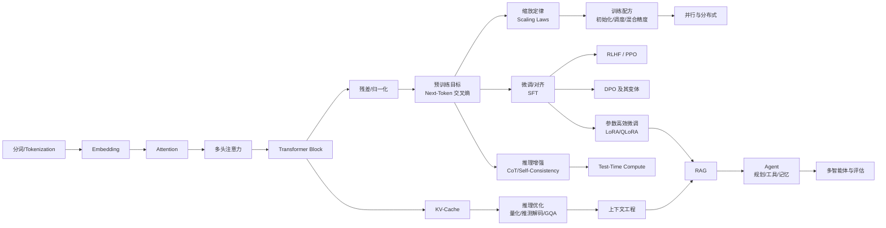

# 普通本科生 12 周掌握大模型（LLM）与 Agent 理论
## ——基于《学习方法论》改造的可执行作战手册

> 一句话总纲：
> **大模型知识是一张有依赖关系的图，不是一篇文章。先用 3 天广度优先建出这张图的骨架，再用 9 周深度优先攻克 10 个高杠杆节点，其余概念一律"用到再查"。**
> 掌握标准不是"我读过这篇论文"，而是"我能自己推导、能自己写出来、能预测改条件后会发生什么、能指出它什么时候失效"。

---

## 第 0 章 为什么原方法不能直接照搬

《学习方法论》的核心是六轮循环：**定靶 → 扫图 → 拆块 → 推演 → 验证 → 固化**，外加一套"可控留白"的提问技术。方向完全正确，但直接拿来学大模型会踩三个坑：

| 原方法的表述 | 学大模型时的具体风险 | 本手册的修正 |
|---|---|---|
| "快速浏览建立地图" | 大模型的资料是论文+代码+博客混合体，纯浏览会得到一堆**互不相连的术语**（QKV、RoPE、GQA、DPO、MoE…），产生"我见过=我懂"的错觉 | 浏览必须**产出可粘贴的图**（问题树/概念图/方法表），且必须标出依赖方向 |
| "逐层递进，一次搞懂一个概念" | 大模型的层级是**螺旋**的：注意力、训练目标、训练配方这三层会在数据、架构、训练、应用四个视角各出现一次。想一次学透会卡死 | 改成**螺旋上升**：同样四层，分 4 遍学，每遍只加一层深度 |
| "大量陌生概念要抓二八" | 抓错了二八：把时间花在 LangChain API、提示词技巧上，而在 attention、loss、训练配方上欠债，导致永远停在"调包侠"层 | 明确给出**高杠杆点清单**（第 2 章），并规定 60% 时间必须投入这 10 个点 |

**最关键的认知转变**（来自原文档第 8 节和结论）：

> 快速掌握 = 快速建立一个**可迭代的框架**，而不是一次学透。
> 广度优先建图，深度优先攻坚关键节点；不能跳层，但可以反复回来。

---

## 第 1 章 第 0 步（4 小时内做完）：前置清零自查

不要重学数学。只做一次**口头自查**，讲得出来就跳过，讲不出来才补，且只补"最小可用版本"。

| 前置项              | 最低通过标准（能口头/纸上讲清即可）                             | 不合格时的最小补法                                                  |
| ---------------- | ---------------------------------------------- | ---------------------------------------------------------- |
| 线性代数             | 矩阵乘法三种理解：行·列点积 / 列的线性组合 / 对向量的变换；什么是向量空间中的"投影" | 3Blue1Brown《线性代数的本质》看 4 集，只求几何直觉                           |
| 微积分/梯度           | 为什么梯度下降走**负**梯度方向；链式法则在反向传播里到底在传什么             | 手推 2 层 MLP 的反向传播一遍（必须做，否则后面 loss 曲线永远靠猜）                   |
| 概率               | 期望/方差；最大似然估计为什么等价于最小化交叉熵；条件概率与贝叶斯              | 只需推一遍"二分类交叉熵 ↔ 伯努利最大似然"                                    |
| 信息论              | 熵、交叉熵、KL 散度各自衡量什么；为什么语言模型用交叉熵                  | 记住一句话：**训练 LLM = 最小化 next-token 的交叉熵 = 最小化 KL(数据分布‖模型分布)** |
| Python / PyTorch | 类与张量形状变换；广播机制；`autograd` 是怎么从 loss 反推到参数的      | 手写一个 autograd 迷你版（Karpathy micrograd，2 小时）                 |
| 算力常识             | batch 并行、GPU 显存是瓶颈、fp16/bf16 的区别               | 会用 `nvidia-smi` 看显存；知道 1B 参数 × fp16 ≈ 2GB                  |

> 原则：**前置只补"卡住下一步"的部分**。不要在开学前把《统计学习方法》读完，那是典型的用低杠杆活动逃避高杠杆活动。

---

## 第 2 章 领域总图：第一轮必须产出的三样东西

### 2.1 问题树（LLM 到底在解决什么）

```
根问题：如何让机器从海量文本中习得"预测下一个词"的能力，并让这个能力表现为可用的推理与行动？
├─ Q1 表示：文字怎么变成数字？（分词、嵌入、位置）
├─ Q2 建模：用什么结构把上下文压成对下一个词的分布？（Transformer、注意力）
├─ Q3 目标：优化什么函数就算"学到了"？（交叉熵、缩放定律）
├─ Q4 训练：怎么在有 bug、会爆炸、吃显存的情况下真的训出来？（初始化、归一化、调度、并行）
├─ Q5 对齐：预训练的"续写机器"怎么变成"听指令的助手"？（SFT、RLHF、DPO）
├─ Q6 推理：为什么"多想一会儿"会更聪明？算力该花在训练还是推理？（CoT、test-time compute）
├─ Q7 落地：怎么接入外部知识、工具、记忆，变成 Agent？（RAG、tool use、memory、多智能体）
└─ Q8 评价：怎么知道它真的好？会不会骗人？（benchmark、评估、安全）
```

### 2.2 概念依赖图（把这张图抄进你的笔记第一页）



**读图规则（重要）**：箭头是"必须先懂左边，才可能真懂右边"。
- 不懂 Attention 就学 RoPE = 背书。
- 不懂 Next-Token 交叉熵就学 DPO = 背公式。
- 不懂 KV-Cache 就学量化/推理优化 = 背名词。

### 2.3 方法表（论文阅读模板，每篇论文填一行）

| 字段 | 要写什么 |
|---|---|
| 解决什么问题 | 一句话，且必须写成"输入 → 输出"的形式 |
| 之前方案为什么不行 | 必须写出**具体失败模式**，不能写"效果不好" |
| 核心机制 | 一句话 + 一个公式或一张图 |
| 替代方案 | 至少 2 个，以及本文为什么选这个 |
| 代价 | 显存 / 算力 / 延迟 / 数据需求 / 工程复杂度 |
| 失败模式 | 什么时候不适用？边界条件是什么？ |
| 与前后论文的关系 | 它继承了谁、被谁取代、为什么 |

---

## 第 3 章 高杠杆点清单：60% 时间必须花在这 10 个点

按"学会了它，就能自己推出周边一堆东西"的能力排序。

| #   | 高杠杆点                            | 杠杆效应                                                            | 达标动作                                           |
| --- | ------------------------------- | --------------------------------------------------------------- | ---------------------------------------------- |
| 1   | **Attention 的本质**               | 它是"可学习的加权平均 + 检索"。懂了这个，位置编码、KV-Cache、FlashAttention、长上下文全部变成推理题 | 手写 scaled dot-product attention，并解释为什么要除以 √d_k |
| 2   | **Next-Token 交叉熵**              | 它同时是训练目标、评估指标（PPL）、缩放定律的纵轴、采样温度的来源                              | 从最大似然推出交叉熵；推理为什么可以用它算 PPL                      |
| 3   | **缩放定律**                        | 决定了"该花多少钱、该多大模型、该多少数据"，是工程决策的地基                                 | 能说明 Chinchilla 相对 Kaplan 修正了什么                 |
| 4   | **残差 + Pre-LN**                 | 解释了深层网络为什么能训起来、梯度为什么会消失/爆炸                                      | 能手推残差如何让梯度有一条"高速公路"                            |
| 5   | **训练配方四件套**（初始化/调度/warmup/混合精度） | 90% 的"loss 不降/NaN"问题都在这里                                        | 能诊断 loss 曲线：平台、尖峰、NaN 分别查什么                    |
| 6   | **KV-Cache**                    | 推理显存与延迟的主要来源，是所有推理优化的起点                                         | 能估算：序列长度 × 层数 × 头数 × d_head × 2 × dtype 的显存    |
| 7   | **SFT 与 RLHF/DPO 的分工**          | 决定了"模型为什么不听话"以及该用哪个阶段修                                          | 能说清 PPO 里四个模型各是谁、DPO 去掉了谁                      |
| 8   | **LoRA / 量化**                   | 让本科生也能在单卡上做微调，是"从理论到能动手"的闸门                                     | 能用 LoRA 微调一个 0.5B 模型并解释 rank 的含义               |
| 9   | **RAG 全链路**                     | 工程回报最高，且能反向加深对 embedding/注意力的理解                                 | 能画出 chunk→embed→检索→重排→拼接→生成的链路与各环节失败模式         |
| 10  | **Agent 三件套**（规划/工具/记忆）         | 泛化到所有"LLM + 外部世界"的问题                                            | 能写一个 100 行以内的 ReAct Agent（不用框架）                |

**明确"只用会用"的部分**（不要深挖，会看但会查即可）：
分布式并行细节、CUDA kernel 优化、MoE 路由实现、多智能体辩论、具体框架 API。
> 判断标准：**"如果它变了，我前面学的东西会不会白学？"** 会 → 深挖；不会 → 会用即止。

---

## 第 4 章 核心操作循环：把"可控留白"落到代码和公式上

这是《学习方法论》第 2 篇的直接应用，但改造成大模型专用的形式。

### 4.1 单次学习循环（每个 90 分钟 block 照做）

> **先问 → 先猜 → 遮住补全 → 对答案 → 标缺口 → 重讲一遍 → 换条件再问 → 隔天再测**

具体到大模型材料：

1. **先问**（5 min）：把标题/概念改写成问题。
   - 不是"学习 RoPE"，而是："没有位置编码会怎样？为什么绝对位置编码外推差？RoPE 怎么把位置信息变成旋转？为什么旋转能带来相对位置性质？"
2. **先猜**（10 min）：合上资料，写下你当前的答案，允许写错。**这一步不能跳**——它是产生"可解但未解"模糊的唯一方式。
3. **遮住补全**（30 min）：读资料/论文/代码时主动遮挡：
   - 数学：遮住公式里某个符号，先问"为什么这里是负号/为什么除以 √d_k"。
   - 代码：先看函数签名和 shape 注释，**自己写实现**，再对照官方实现。
   - 论文：遮住下一段结论，先猜作者的动机。
4. **对答案**（15 min）：只补卡住的地方，不重读全部。用四种标记红笔标注：
   `[概念不懂]` `[关系不清]` `[推理断点]` `[边界不明]`
5. **修正输出**（15 min）：用自己的话重写推导链或代码，并写一段 100 字的费曼解释。
6. **换条件再问**（10 min）：至少问 3 个变式。
   - 去掉这个假设会怎样？→ 例如"如果 attention 不做 softmax 会怎样？"（答：退化成线性加权，失去选择性聚焦）
   - 换成相反的数据会怎样？
   - 扩大到 10 倍规模会怎样？→ 这一问能引出缩放定律和工程约束
7. **隔天再测**（5 min）：把问题写进卡片，1/3/7/14 天后**先答题再看资料**。

### 4.2 不同知识类型用不同的留白方式

| 知识类型 | 大模型中的例子 | 留白方式 |
|---|---|---|
| 术语/事实 | RoPE、GQA、LoRA、MoE | 闪卡填空；但填完必须追问"它为什么重要？和什么相对？" |
| 概念/关系 | Attention↔KV-Cache，SFT↔RLHF | 概念图缺口：给出节点，自己补箭头和关系词 |
| 原理/推导 | 交叉熵推导、缩放定律、DPO 的闭式解 | **遮住下一步先猜**；合上资料整链重推 |
| 代码/工程 | 手写 GPT、手写 LoRA、手写 ReAct | **先猜输出再运行**；先写实现再看参考实现 |
| 案例/决策 | "该选 RAG 还是微调？" | 先写"我会怎么做、为什么"，再看别人的答案 |

### 4.3 好留白的四个条件（自检）

- **可解**：有足够线索，不是猜谜。
- **有反馈**：能马上用代码运行/查资料验证。
- **有目标**：知道补全它是为了解决哪个上层问题。
- **有梯度**：填空 → 简答 → 推理 → 实践，难度递增。

坏留白示例：`"谈谈 Transformer。"`（太宽）／`"为什么 attention 好？"`然后永远不查答案（无反馈）／连续 2 小时处于"想不出来"状态（焦虑抢占注意，应立即降级为填空或看答案）。

---

## 第 5 章 12 周作战计划

每周结构固定：**靶心问题（定靶）／固定资源（扫图）／必须产出的交付物（拆块+推演）／检验标准（验证）**。
**交付物是不可协商的**——只看不产出，就是原文档批评的"走马观花"。

---

### 阶段一：建骨架（第 0–2 周）｜目标：拥有整张地图 + 能跑通黑盒

#### 第 0 周（3 天）：定靶 + 扫图
- **靶心**：这张图上有哪些节点？依赖方向是什么？我已有的前置缺哪块？
- **资源**：3Blue1Brown 神经网络 4 集；Karpathy「Deep Dive into LLMs」/「Intro to LLMs」讲座（选一个）；一篇高质量综述（如 "A Survey of Large Language Models"）。
- **交付物**：① 手抄版概念依赖图（不许复制，必须重画一遍）；② 问题树（第 2.1 节模板）；③ 前置自查表（第 1 章）。
- **检验**：合上一切资料，在 A4 纸上画出 20 个节点以上的依赖图，并说出任意三个相邻节点的"为什么必须先学"。
- **常见坑**：把这一周拖成一个月。**硬性 3 天截止。**

#### 第 1 周：表示层 + 黑盒体验
- **靶心**：文字怎么变成数字？"预测下一个词"在工程上是什么样？
- **资源**：Karpathy nanoGPT 的 `prepare.py`（BPE）；`tiktoken`；HuggingFace 上一本中文书的 tokenizer 实验。
- **交付物**：
  1. 用 tokenizer 对同一段中英文分别分词，统计 token/字符比，写 200 字结论：**为什么这直接决定了中文 API 成本和上下文长度**。
  2. 用 `transformers` 跑一个开源小模型，手动实现 temperature / top-k / top-p 采样，输出同一 prompt 的 5 种结果。
- **检验**：能解释"为什么 temperature=0 仍可能不唯一""为什么 top-p 通常比 top-k 好"。
- **常见坑**：跳过分词直接学注意力。分词是"数据—模型"的接口，跳过它后面所有成本直觉都是错的。

#### 第 2 周：手写 Bigram 语言模型
- **靶心**：一个"语言模型"的最小完整闭环是什么？（数据 → 前向 → loss → 反向 → 采样）
- **资源**：Karpathy「Let's build GPT from scratch」（第 1 段，到 bigram 结束）。
- **交付物**：一个能跑通的 `bigram.py`：读 txt → 建词表 → embedding 查表 → 交叉熵 → 训练循环 → 生成文本。
- **检验**：能不看代码说出 tensor 的每一步 shape 变化；能解释"为什么这里 loss 能降到接近 log(词表大小) 以下"。
- **常见坑**：抄代码跑通就以为学会了。**必须手打一遍，且关掉参考自己重写一遍。**

---

### 阶段二：手写一个 GPT（第 3–5 周）｜目标：架构不再是黑盒

**核心方法：单点升级法。** 每一步只加一个改进，且**必须先说明它修复了上一步的什么具体痛点**。

#### 第 3 周：从 Bigram → 单头自注意力
- **靶心**：为什么"静态加权平均"不够？Q/K/V 各自在干什么？为什么除以 √d_k？
- **资源**：nanoGPT 视频第 2 段；《Attention Is All You Need》只读 §3.2；
  Jay Alammar「The Illustrated Transformer」（先看自己的实现，再看它的图）。
- **交付物**：
  1. 手写 `scaled_dot_product_attention`（**不许调用** `F.scaled_dot_product_attention`），并用一个 3×3 的玩具例子打印注意力矩阵，观察它是怎样把"看哪里"变成权重的。
  2. 写一页推导：**为什么 softmax 前要缩放？**（答到"点积随维度增大导致方差增大 → softmax 饱和 → 梯度消失"这一层）
  3. 因果掩码（causal mask）的实现 + 解释"为什么训练时能并行看全文，推理时不能"。
- **检验**：给出一个 4×4 的 attention 矩阵，能判断它是否满足因果性；能说出去掉缩放后训练会怎样。
- **留白练习**：遮住 `masked_fill(-inf)` 那一行，先猜掩码该怎么写。

#### 第 4 周：Transformer Block 完整化（多头 + 位置 + 残差 + LN）
- **靶心**：多头相比单头多得到了什么？没有位置编码会怎样？残差和 LayerNorm 各自救的是什么？
- **资源**：nanoGPT 视频第 3 段；Pre-LN vs Post-LN 的对比（读 `On Layer Normalization in the Transformer Architecture` 的摘要+结论）；RoPE 只读摘要和一张图。
- **交付物**：
  1. 完整可训练的 GPT（几百万参数级），在莎士比亚/tiny shakespeare 上训练；贴出 loss 曲线截图。
  2. **消融实验表（本阶段最重要的产出）**：分别关掉多头、位置编码、残差、LayerNorm，各训 500 步记录 loss。用这张表回答"每一部分到底值多少钱"。
  3. 一页说明：为什么现在主流用 Pre-LN + RMSNorm。
- **检验**：能预测每个消融实验的失败模式（例如去掉残差 → 深层梯度消失，loss 卡住）。
- **常见坑**：只看论文图，不做消融。**没有消融，你的"理解"只是背书。**

#### 第 5 周：训练配方与调试（把"能训"变成"训得对"）
- **靶心**：为什么我的 loss 不降/爆炸/变 NaN？模型规模变大后该调什么？
- **资源**：nanoGPT 的 `train.py`；GPT-2 论文里关于初始化（0.02 缩放）的部分；混合精度与 `GradScaler`；Karpathy「A Recipe for Training Neural Networks」。
- **交付物**：
  1. **loss 故障诊断表**：loss 不降 / 一开始就爆炸 / 中途出尖峰 / 变 NaN / 验证集上升，各写"最可能的 3 个原因 + 验证手段"。
  2. 实测学习率扫描：`1e-2 / 1e-3 / 1e-4` 的曲线对比，写结论。
  3. 加上 warmup + cosine 调度 + 梯度裁剪 + bf16，对比效果。
  4. 权重初始化实验：标准正态 vs `0.02` 缩放 vs Xavier，看残差累积对输出的影响。
- **检验**：给你一条陌生的 loss 曲线，你能给出 3 个假设和对应的验证动作。
- **本阶段结束的里程碑**：你能在没有教程的情况下，从空白文件写出一个能训练的 GPT。这就是"第三级掌握"。

---

### 阶段三：训练、缩放与对齐（第 6–9 周）｜目标：理解"大"和"听话"

#### 第 6 周：缩放定律
- **靶心**：钱该花在参数上还是数据上？"涌现能力"是真的吗？
- **资源**：`Scaling Laws for Neural Language Models`（Kaplan 2020，读摘要+图1+结论）；`Training Compute-Optimal LLMs`（Chinchilla，读摘要+图1）；`Emergent Abilities of LLMs` + 其质疑文章（如 `Are Emergent Abilities a Mirage?`）**对读**。
- **交付物**：
  1. 一页对比：Kaplan vs Chinchilla 的核心差别是什么，为什么后者改变了业界的数据配比。
  2. 用自己的话解释"用指标不连续就宣称涌现"这个方法论陷阱。
  3. 估算题：给定 1e22 FLOPs 预算，估算参数量与 token 数的最优配比（按 Chinchilla 约 20 token/参数）。
- **检验**：能回答"为什么现在大家还在训远超 Chinchilla 最优的模型？"（答：推理成本与质量的非线性收益、数据质量、下游价值）

#### 第 7 周：规模化训练工程（浅层但要有正确直觉）
- **靶心**：一个模型装不进一张卡时，工程上怎么拆？
- **资源**：`ZeRO` 论文摘要；Megatron-LM 的并行度概念；混合精度与激活重计算的直觉说明。
- **交付物**：一张表，写清**数据并行 / 张量并行 / 流水线并行 / ZeRO** 各自"拆的是什么维度、通信代价在哪、什么时候用它"。
- **检验**：能回答"为什么张量并行通信量大、通常放在机内；流水线并行有气泡、通常放在机间"。
- **明确不深挖**：不写 CUDA kernel，不实现分布式。**这是"会用能查"层。**

#### 第 8 周：微调与参数高效方法
- **靶心**：为什么全量微调贵？LoRA 为什么能用极低参数学到接近的效果？
- **资源**：`LoRA` 论文摘要 + 公式；`QLoRA` 摘要；HuggingFace PEFT 文档。
- **交付物**：
  1. **手写 LoRA 层**（几十行：A、B 低秩矩阵 + 缩放 α/r），插入到一个模型的线性层里。
  2. 单卡（或 Colab）微调一个 0.5B 模型做某个小任务，报告显存占用。
  3. 实验：rank = 4 / 8 / 32 对比；冻结 A 或冻结 B 对比；写出"为什么 B 初始化成 0"。
- **检验**：能解释 LoRA 的可训练参数量公式，并能估算任意模型的 LoRA 显存节省。
- **常见坑**：把 LoRA 当成魔法参数调。要能说出它假设了"微调所需的权重更新是低秩的"。

#### 第 9 周：对齐（SFT → RLHF → DPO）
- **靶心**：预训练模型是怎么变成"助手"的？为什么需要人类偏好？DPO 到底简化掉了什么？
- **资源**：`InstructGPT`（读摘要+图 2 流程图）；`Training language models to follow instructions with human feedback` 的 PPO 部分；`DPO` 论文摘要 + 目标函数。
- **交付物**：
  1. **一张四个模型的图**：PPO 里 actor / critic / reward model / reference model 各自是谁、参数是否共享、各自在优化什么。**这张图是本周唯一硬指标。**
  2. 对比表：SFT / RLHF(PPO) / DPO / RLAIF 的"数据需求、稳定性、算力、失败模式"。
  3. 一页推导 DPO 的核心思路：把 reward 表达成策略与参考模型的 log 比，从而绕过显式奖励模型。
  4. **失败模式清单**：reward hacking、过度拒答、谄媚（sycophancy）、多样性下降 —— 各举一个真实表现。
- **检验**：能解释"为什么 DPO 不需要 reward model 但仍需要 reference model"。
- **常见坑**：把 RLHF 当成"强化学习课"。它本质是**用人类偏好定义目标函数**。

---

### 阶段四：推理、检索与 Agent（第 10–12 周）｜目标：从理论走到能用的系统

#### 第 10 周：推理优化与"想得更久"
- **靶心**：为什么生成比训练慢？KV-Cache 省了什么又贵了什么？"多想一会儿"为什么会更准？
- **资源**：`Chain-of-Thought Prompting`；`Self-Consistency`；`Large Language Monkeys` 或 `s1`（test-time compute）；KV-Cache / GQA / 推测解码的博客讲解；`FlashAttention` 摘要。
- **交付物**：
  1. **显存估算器**：写一个小脚本，输入 层数/头数/d_head/序列长度/精度，输出 KV-Cache 占多少 GB。并用它解释"为什么长上下文那么贵"。
  2. 一页对比：GQA / MQA / MHA 在"质量—显存—吞吐"上的取舍。
  3. **实证**：同一个数学题，让模型（或你自己模拟的 prompt 流程）分别用 直接回答 / CoT / CoT+自一致投票 各跑若干次，统计准确率并画表。
  4. 一页说明：为什么"训练时算力 vs 推理时算力"存在新的权衡曲线。
- **检验**：能解释 KV-Cache 与注意力计算量的关系、为什么 GQA 能同时省显存和带宽。
- **留白练习**：先猜"KV-Cache 里存的是 K 和 V 还是 Q？为什么？"（答：K、V 因为要对新 token 复用；Q 只与当前位置有关）

#### 第 11 周：RAG 与外部知识
- **靶心**：模型不知道的事怎么让它知道？检索错了会怎样？
- **资源**：`Retrieval-Augmented Generation` 原论文摘要；一篇 embedding 模型介绍（如 BGE / E5）；重排（rerank）简介。
- **交付物**：
  1. **不调框架**，用 numpy + 一个 embedding 接口手写 RAG：切块 → 向量化 → 余弦相似度检索 → 拼 prompt → 生成。
  2. **失败模式清单（必须具体）**：切块切断语义、embedding 对否定/数字不敏感、召回了但排序错、上下文塞太多导致"迷失在中间"、模型无视检索内容编答案。每条给出一个你能构造的复现例子。
  3. 对比实验：只用检索 vs 只用模型参数知识 vs 二者结合，在 20 个你自己出的问题上打分。
- **检验**：能回答"什么时候 RAG 不如微调？什么时候必须 RAG？"（提示：知识时效性/可追溯性 → RAG；行为风格/格式稳定性 → 微调）
- **常见坑**：把 RAG 当"接个向量库"。真正的难点在**切块策略 + 重排 + 上下文组织**。

#### 第 12 周：Agent 与系统整合
- **靶心**：LLM 怎么从"回答问题"变成"完成任务"？它会在哪里失败？
- **资源**：`ReAct` 论文；`Toolformer` 或 function calling 文档；`Reflexion`；一篇 Agent 综述的"规划/记忆/工具"分类部分。
- **交付物**：
  1. **不用任何 Agent 框架**，手写一个 ≤150 行的 ReAct Agent：能调用 2 个真实工具（如计算器 + 本地文件检索），输出可审计的 thought/action/observation 轨迹。
  2. **Agent 失败模式清单**：死循环、工具参数幻觉、错误累积、上下文爆炸、幻觉工具结果、过早放弃。每条附上你的实际日志片段。
  3. **最小评估集**：15 个任务，定义成功率，跑 3 次报告方差（**方差常常比准确率更重要**）。
  4. **总复盘（本手册的最终交付物）**：重画第 2 章的概念图，用红笔标出"我现在能深挖的节点"和"我仍只会用的节点"；写一页《我的 12 周认知变化史》。
- **检验**：能对一个陌生需求（如"帮我把周报自动化"）给出方案选择：用 prompt？RAG？微调？Agent？并说明代价与失败风险。

---

## 第 6 章 掌握度自评量表（每周日填一次）

不要用"我读完了"衡量。用四个等级：

| 等级  | 名称      | 通过标准                           | 典型证据                   |
| --- | ------- | ------------------------------ | ---------------------- |
| L1  | 认得      | 能说出术语，能认出来                     | 能解释缩写                  |
| L2  | 能解释     | 能用自己的话说明"解决什么问题、怎么做、为什么这样做"    | 3 分钟口头讲解               |
| L3  | 能推导/能实现 | 能自己写出公式推导或可运行代码；能处理变式          | 空白文件手写实现；变式题做对         |
| L4  | 能批判/能迁移 | 能指出局限、能设计替代方案、能预测改条件后的后果、能诊断失败 | 消融实验设计；失败模式清单；给别人的方案挑错 |

**规则**：
- **每个核心节点必须达到 L3，但不必所有节点都到 L4。**
- 低于 L3 的节点 → 写入下周的间隔检索清单，而不是重读资料。
- 每 3 周做一次"零资料复现"：合上一切，从空文件重写一次核心实现。

### 每周复盘三问（写在同一个文件里，累积成你的学习日志）
1. 这周我**产出**了什么能被别人检验的东西？（没有产出 = 这周没学）
2. 我**卡住**的地方具体是哪一步？（要写到"哪一行公式/哪个 shape"的粒度）
3. 我遇到了哪个**与我预期相反**的事实？（没有反例 = 理解太浅）

---

## 第 7 章 抗干扰与可持续（来自《学习方法论》第三篇）

学习大模型的过程最容易死于"上下文重建成本"：被打断后不知道自己在推导哪一步，于是从头重来，越来越挫败。原文的解法直接用在这里。

- **物理层优先**：手机放另一个房间；用 `pytorch` 训练跑着的时候做阅读，训练结束做推导（把等待时间变成复习时间）。
- **外化降低重建成本**：每个 90 分钟 block 结束写 3 行——"我解决了什么 / 下一步是什么 / 断点在哪"。回来后**只看这 3 行**，不从头重读。
- **不追求不受干扰，追求快速回锚**：被打断后按 `停→标→呼→锚→接` 五步，30 秒内接上；画一笔"回锚计数"。目标不是零干扰，是恢复时间从 5 分钟降到 30 秒。
- **情绪不压制只标记**：卡在某个数学推导时，写"这里是理解缺口，不是我不行"，然后立刻降级为填空或看答案（好留白的"有反馈"条件）。
- **睡眠与运动**：巩固记忆，降低认知负荷。熬夜学 Transformer 是负收益。
- **允许"暂时不懂"但要排期**：把不懂的点写进"不确定性清单"，明确安排反馈时间，不让它在脑内循环。

---

## 第 8 章 反面清单：本科生学大模型最常见的 12 个坑

1. **从 LangChain 开始**。倒过来了。应该从 Bigram → GPT → 训练 → 微调 → 再 Agent。
2. **看视频不做复盘**。"看懂了"是幻觉，`只能重建` 才是证据。
3. **试图读完所有论文**。论文是查的，不是读的。只精读那 10 个高杠杆点相关的。
4. **跳过分词和数据处理**。结果永远没有成本直觉。
5. **只看公式不写代码**。不看代码，你无法知道 alibi、mask、scale 到底写在哪一行。
6. **只写代码不懂公式**。结果无法诊断失败，只能调参撞运气。
7. **没有消融实验**。这是"理解"和"背书"的分界线。
8. **把 RLHF 当强化学习课学**。它的重点是目标函数的来源。
9. **过早追求最新论文**。基础节点没到 L3 时，新论文只会增加术语噪声。
10. **追求 L4 全覆盖**。时间和收益不成比例；只在 10 个杠杆点上追求批判层。
11. **缺少间隔检索**。三天后忘光，然后误判"我记忆力差"。
12. **把"能用框架搭出 demo"当成掌握**。那是工程熟练度，不是理论掌握度。

---

## 第 9 章 泛化模板：把这套方法迁移到任何新领域

本手册的骨架与领域无关，只换三样东西：

| 组成部分 | 换成什么 |
|---|---|
| **地图** | 新领域的核心问题树 + 概念依赖图（必须手画） |
| **杠杆点** | 该领域"学会它就能推出周边"的 8–12 个点。识别方法：问"如果这个点错了/变了，我前面学的会不会全废？"会 → 是高杠杆点 |
| **留白形式** | 该领域的验证渠道。代码可运行 → 先猜输出；数学可推导 → 遮住下一步；实验可复现 → 先预测结果；案例可决策 → 先写方案 |

**各领域的杠杆点示例**：
- 计算机视觉：卷积与归纳偏置、感受野、批归一化、数据增强、检测框回归。
- 系统/分布式：一致性模型、复制与共识、故障模型、性能建模（Little 定律）、尾延迟。
- 机器学习优化：偏差-方差、正则化、凸性与收敛率、泛化界。
- 经济学/社科：供需均衡、激励相容、识别策略（因果推断）、弹性。

**通用 12 周模板**：
1. 周 0：定靶 + 手画依赖图（3 天硬截止）
2. 周 1–2：跑通最小闭环（黑盒 → 最小白盒）
3. 周 3–5：手写核心机制 + **消融实验**
4. 周 6–9：规模化、工程约束、领域特有的"配方"
5. 周 10–12：端到端系统 + 失败模式清单 + 最小评估集

**三条永不改变的规则**：
> 1. 每轮必须有**可被别人检验的产出**。
> 2. 每个结论必须配一个**变式或反例**。
> 3. 每个卡点必须**外化**并排入间隔检索，而不是留在脑内循环。

---

## 附录 A 固定资源清单（按学习顺序，够用即止）

| 阶段 | 资源 | 用法 |
|---|---|---|
| 直觉 | 3Blue1Brown：神经网络 / 线性代数本质 | 只看直觉，不做题 |
| 总览 | Karpathy《Deep Dive into LLMs》/《Intro to LLMs》 | 用来建图，不用来记细节 |
| 架构 | Jay Alammar《The Illustrated Transformer》 | 在写完自己的 attention 之后看 |
| 手写 | Karpathy《Let's build GPT from scratch》+ nanoGPT 仓库 | 分三段看，每段自己重写一遍 |
| 论文 | 《Attention Is All You Need》§3 | 只读架构部分 |
| 缩放 | Kaplan 2020 / Chinchilla 2022 | 摘要 + 图 1 + 结论 |
| 对齐 | InstructGPT / DPO | InstructGPT 读流程图；DPO 读目标函数 |
| 微调 | LoRA / QLoRA + PEFT 文档 | 手写 LoRA 层 |
| 推理 | CoT / Self-Consistency / s1 或 Large Language Monkeys | 做准确率对比实验 |
| 检索 | RAG 原论文 + 一篇 embedding 介绍 | 手写最小 RAG |
| Agent | ReAct + Reflexion | 手写 ≤150 行 Agent |
| 调试 | Karpathy《A Recipe for Training Neural Networks》 | 每周遇到 loss 问题就回来查 |

## 附录 B 论文精读四步法

1. **三句话速读**：标题 + 摘要 + 所有图表的 caption。写下"它声称解决了什么"。
2. **动机与对比**：之前的方案具体怎么失败？本文的核心机制一句话是什么？有没有更简单的替代？
3. **合上论文重建**：自己写出一行目标函数或一张流程图。写不出来 → 没读懂，回去只补那一处。
4. **失败模式转换**：它最可能在什么条件下失效？如果我是审稿人，我会问什么？

## 附录 C 间隔检索卡表

见同目录 `间隔检索卡表.csv`（约 80 张，含概念问答、公式推导、代码留白、对比辨析、数字估算五类）。
用法：导入 Anki 或直接手机表格；**先答题再看答案**；1 / 3 / 7 / 14 天各过一遍。
